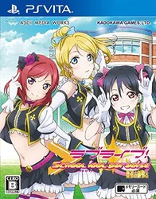
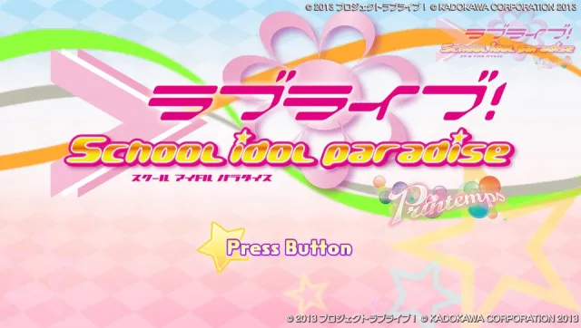
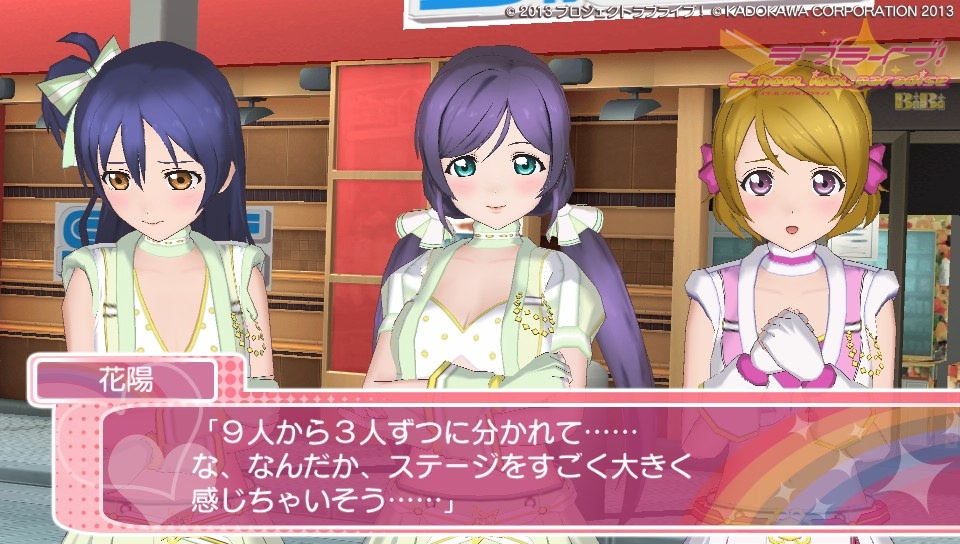
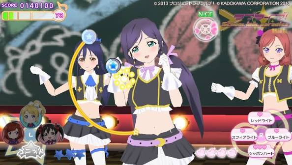

## 📜 러브 라이브! 스쿨 아이돌 파라다이스 Vol.3 lily white 개요

  
  
  
  

**러브 라이브! 스쿨 아이돌 파라다이스 Vol.3 lily white**는 딩고(Dingo Inc.)가 개발하고 카도카와가 2014년 8월 28일 일본에서 발매한 PS Vita용 게임입니다. μ's(뮤즈)의 세 유닛 중 마지막인 **lily white**를 주인공으로 한 시리즈 세 번째 작품으로, 장르는 **라이브 크리에이트 액션**으로 분류됩니다.

곡·의상·스테이지를 직접 선택해 자신만의 라이브 무대를 만들어가는 콘셉트가 이 시리즈 전체의 핵심이며, Vol.3에서는 lily white 특유의 신비롭고 쿨한 매력이 전면에 드러납니다.

---

## 📅 러브 라이브! 스쿨 아이돌 파라다이스 Vol.3 출시 정보

| 항목 | 내용 |
| --- | --- |
| 발매일 | 2014년 8월 28일 (일본) |
| 개발 | 딩고 (Dingo Inc.) |
| 퍼블리셔 | 카도카와 |
| 플랫폼 | PlayStation Vita |
| 장르 | 라이브 크리에이트 액션 |
| 레이팅 | CERO B (12세 이상) |
| 가격 | 패키지판 6,480엔 / 한정판 9,980엔 (세금 별도) |

---

## 🗂️ 스쿨 아이돌 파라다이스 시리즈에서의 위치

| 작품 | 담당 유닛 | 발매년 |
| --- | --- | --- |
| Vol.1 | Printemps (혼카·코토리·하나요) | 2013 |
| Vol.2 | BiBi (마키·니코·에리) | 2013~2014 |
| **Vol.3** | **lily white (우미·린·노조미)** | **2014** |

μ's는 팬투표를 거쳐 세 개의 서브 유닛으로 나뉘었으며, 각 볼륨은 해당 유닛을 중심으로 독립된 라이브 콘텐츠를 제공합니다. Vol.1~3는 기본 수록곡을 공유하면서도, 각 작품마다 담당 유닛 전용곡 5곡이 별도로 추가되는 구성입니다.

---

## 🎤 lily white 유닛 소개

| 멤버 | 특징 |
| --- | --- |
| 소노다 우미 | lily white의 리더, 차분하고 진중한 성격 |
| 호시조라 린 | 밝고 활기찬 분위기의 멤버 |
| 토죠 노조미 | 신비로운 분위기와 영적인 캐릭터성 |

서로 다른 개성을 가진 세 멤버가 모여 있다는 점이 lily white 유닛의 특징으로, Printemps의 발랄함이나 BiBi의 성숙한 매력과는 또 다른 색깔을 보여줍니다.

---

## ⚙️ 핵심 시스템 — 라이브 크리에이트 액션

### 곡·의상·스테이지 선택

이 작품의 핵심은 "곡, 의상, 스테이지 등을 선택해 오리지널 라이브를 만들어낸다"는 콘셉트입니다. 정해진 하나의 공연을 보여주는 것이 아니라, 플레이어가 직접 구성 요소를 조합해 자신만의 무대를 완성하는 것이 다른 리듬 게임과 구별되는 지점입니다.

### 리듬 액션과 라이브 기믹

노트를 정확한 타이밍에 맞춰 터치하는 리듬 게임 요소와, 공연 사이사이 삽입되는 아이돌들의 짧은 이벤트 신인 **라이브 피처**가 결합된 구조입니다. 라이브 피처를 보기 위해서는 **라이브 기믹**을 통해 스타 게이지를 채워야 하는 등, 단순한 노트 처리를 넘어선 라이브 연출 요소가 함께 작동합니다.

### 유닛 전용곡

Vol.1~3 공통 수록곡 외에, lily white 유닛만을 위한 전용곡 5곡이 Vol.3에 추가로 수록되어 있어, 유닛의 개성을 음악으로도 느낄 수 있도록 구성되어 있습니다.

---

## 📦 한정판 구성

통상판 외에 한정판도 함께 발매됐으며, 가격은 9,980엔(세금 별도)으로 통상판보다 특전이 더해진 구성입니다. 다운로드판 역시 5,980엔으로 별도 제공됐으나, 현재는 배포가 종료되어 패키지판으로만 구할 수 있습니다. 시리즈 3부작을 모두 모으려는 수집가들에게는 Vol.1·Vol.2와 함께 세트로 비교해보는 재미도 있는 부분입니다.

---

## 🎨 그래픽·사운드

캐릭터 일러스트와 라이브 무대 연출이 이 작품의 가장 큰 매력 포인트입니다. lily white 멤버들의 의상과 무대 연출이 세심하게 표현되어 있으며, 직접 의상을 골라 조합하는 과정에서 캐릭터를 꾸미는 재미도 함께 느낄 수 있습니다.

사운드는 μ's의 대표곡들과 lily white 전용곡이 중심이며, 라이브 피처의 짧은 이벤트 음성까지 더해져 팬서비스적인 완성도를 높입니다.

---

## 🆚 Printemps·BiBi와는 다른 lily white의 매력

Vol.1의 Printemps가 혼카·코토리·하나요의 발랄하고 친근한 분위기를, Vol.2의 BiBi가 마키·니코·에리의 성숙하고 스타일리시한 매력을 보여줬다면, Vol.3의 lily white는 우미·린·노조미라는 서로 다른 개성의 조합이 만들어내는 독특한 색깔을 중심에 둡니다. 차분한 우미, 발랄한 린, 신비로운 노조미가 한 유닛으로 묶이면서도 자연스럽게 어우러지는 점이 lily white만의 매력으로 꼽힙니다.

같은 시스템을 공유하는 3부작이지만, 유닛마다 전용곡과 캐릭터성이 다르기 때문에 세 작품을 모두 플레이하면 μ's라는 그룹 전체를 더 폭넓게 이해할 수 있는 구성입니다.

---

## 🎯 추천 포인트

- μ's의 서브 유닛 lily white를 좋아하는 분
- 곡·의상·스테이지를 직접 조합해 나만의 라이브를 만들어보고 싶은 분
- 리듬 게임과 아이돌 이벤트 신이 결합된 작품을 원하는 분
- Vol.1·Vol.2에 이어 시리즈를 모두 수집하고 싶은 분

---

## 💡 러브 라이브! 스쿨 아이돌 파라다이스 Vol.3 공략 팁

### 라이브 구성
- 곡 난이도와 의상·스테이지 조합을 다양하게 시도해보며, 자신에게 맞는 플레이 스타일을 먼저 파악할 것

### 라이브 기믹 활용
- 스타 게이지를 채우는 라이브 기믹을 적극적으로 활용해야 라이브 피처 이벤트를 놓치지 않고 감상할 수 있음

### 유닛 전용곡 우선 플레이
- lily white 전용곡부터 플레이하면 이 작품만의 개성을 먼저 체감할 수 있어 입문하기 좋음

---

## 🎮 러브 라이브! 스쿨 아이돌 파라다이스 Vol.3 플레이 후기

정해진 하나의 공연이 아니라, 곡·의상·스테이지를 직접 골라 나만의 라이브를 완성해간다는 콘셉트가 이 시리즈만의 개성을 잘 보여준다. lily white라는 신비롭고 차분한 색깔의 유닛을 중심으로 한 구성 덕분에, 앞선 Printemps·BiBi 작품들과는 또 다른 분위기를 느낄 수 있다.

리듬 액션 자체는 복잡하지 않지만, 라이브 기믹으로 스타 게이지를 채워 이벤트 신을 감상하는 구조가 팬서비스와 게임성을 적절히 엮어낸다. μ's 팬이라면 세 유닛을 모두 수집해 비교해보는 재미도 분명 있는 작품이다.

---

## 🔗 러브 라이브! 스쿨 아이돌 파라다이스 Vol.3 참고 링크

- [ラブライブ! School idol paradise Vol.3 lily white - KADOKAWA](https://www.kadokawa.co.jp/product/game1606/)
- [Lily white - Love Live! Wiki (Fandom)](https://love-live.fandom.com/wiki/Lily_white)
- [Love Live!: School Idol Paradise - Vol.3: Lily White - MobyGames](https://www.mobygames.com/game/79552/love-live-school-idol-paradise-vol3-lily-white-shokai-genteiban/releases/ps-vita/)
- [Love Live! School Idol Paradise Vol. 3 - Lily White Unit - The Video Games Museum](https://www.video-games-museum.com/en/game/Love-Live-School-Idol-Paradise-Vol-3-Lily-White-Unit/102/5/49925)
- [ラブライブ！ School idol paradise Vol.3 lily white Trophy Guide - PSNProfiles](https://psnprofiles.com/guide/3770-%E3%83%A9%E3%83%96%E3%83%A9%E3%82%A4%E3%83%96-school-idol-paradise-vol3-lily-white-trophy-guide)
