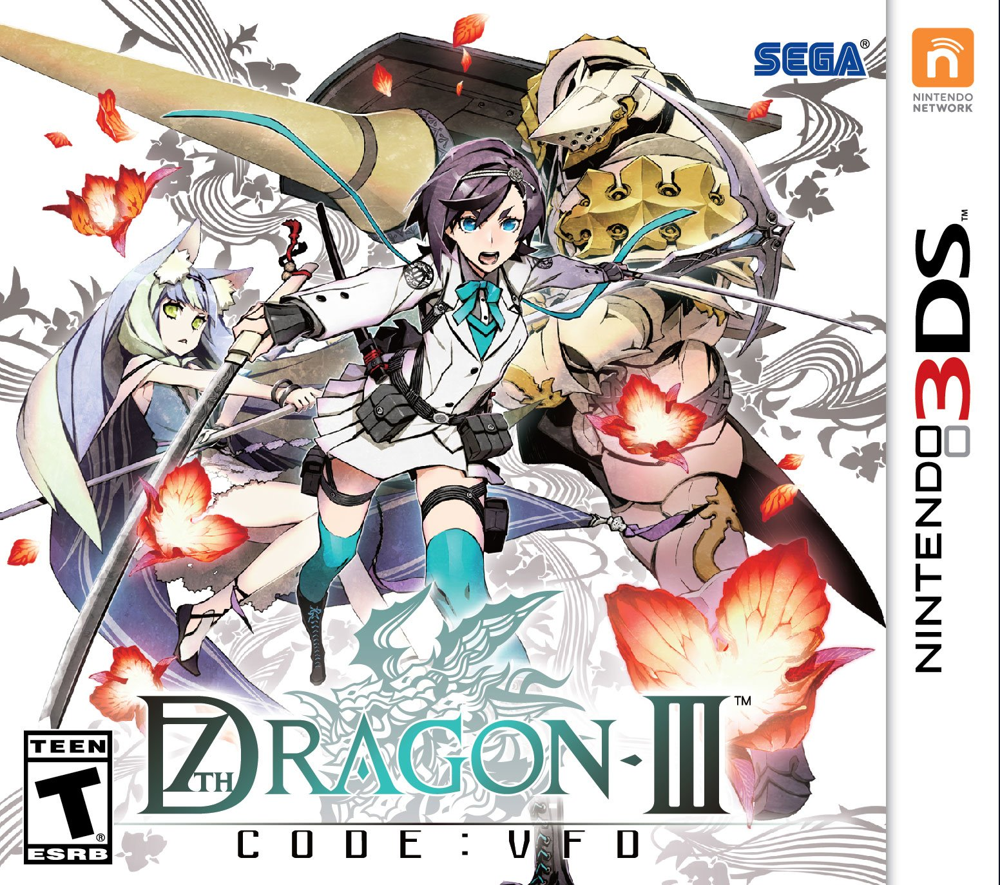
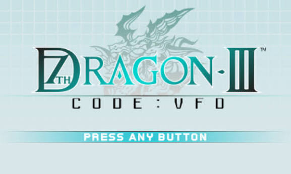
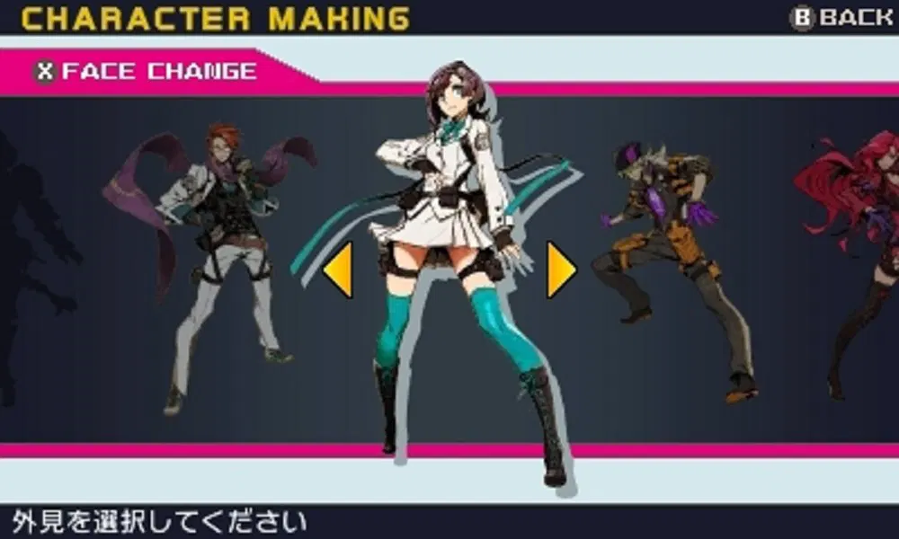
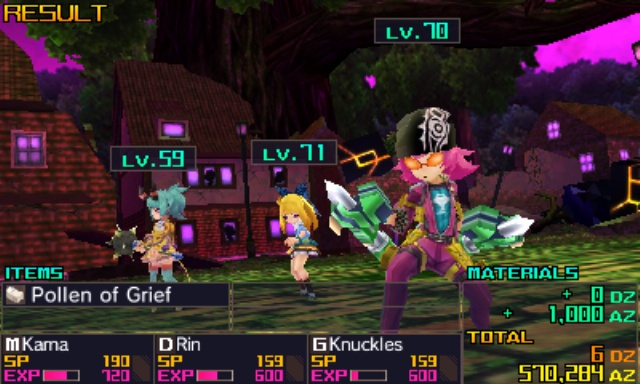

## 📜 7th드래곤 3 코드:VFD 개요

  
  
  
  

**7th드래곤 3 코드:VFD(7th Dragon III Code: VFD)**는 세가가 2015년 10월 15일 일본에서 발매한 닌텐도 3DS용 던전 탐험형 RPG입니다. 북미에는 2016년 7월 12일, 유럽에는 12월 1~2일 발매되며 Deep Silver가 유통을 맡았습니다. 캐릭터 디자인은 미와 시로우, 음악은 코시로 유조가 담당했습니다.

2009년 DS로 시작된 7th드래곤 시리즈와, 근미래 도쿄를 무대로 했던 스핀오프 **7th드래곤 2020·2020-II**의 이야기를 모두 이어받아 마무리하는 시리즈 완결편으로, 서로 다른 시대를 넘나드는 시간여행 요소가 이 작품의 핵심 테마입니다.

---

## 📅 7th드래곤 3 코드:VFD 출시 정보

| 항목 | 내용 |
| --- | --- |
| 일본 발매 | 2015년 10월 15일 |
| 북미 발매 | 2016년 7월 12일 |
| 유럽 발매 | 2016년 12월 1~2일 |
| 퍼블리셔 | 세가 (유럽: Deep Silver) |
| 캐릭터 디자인 | 미와 시로우 |
| 음악 | 코시로 유조 |
| 플랫폼 | 닌텐도 3DS |
| 장르 | 던전 탐험형 RPG |

---

## 🗂️ 7th드래곤 시리즈 계보

| 작품 | 플랫폼 | 발매년 | 비고 |
| --- | --- | --- | --- |
| 7th드래곤 | NDS | 2009 | 시리즈 원점, 중세 판타지 배경 |
| 7th드래곤 2020 | PSP | 2011 | 근미래 도쿄 무대 스핀오프 |
| 7th드래곤 2020-II | PSP | 2013 | 하츠네 미쿠 컬래버로 화제, 2020의 직접 속편 |
| **7th드래곤 3 코드:VFD** | **3DS** | **2015** | **2020·2020-II로부터 80년 뒤인 2100년, 시리즈 완결편** |

코드:VFD는 2020·2020-II의 사건이 벌어진 지 80년이 지난 **2100년**을 배경으로 삼아, 근미래 스핀오프와 오리지널 판타지 시리즈의 세계관을 하나로 묶어내는 역할을 합니다.

---

## 📖 스토리 개요

2100년, **노덴스 사**는 완전히 각성하기 전의 일곱 번째 진정한 드래곤을 막기 위해 과거 드래곤들의 흔적을 모아 **드래곤 크로니클**을 완성하려 합니다. 이를 위해 과학자 **줄리에타**가 만든 **타임머신**을 이용해, 플레이어는 과거와 미래를 오가며 드래곤의 샘플을 수집하는 임무를 맡습니다.

첫 목적지는 기술적으로 발전한 과거의 해저 왕국 **아틀란티스**이며, 이후에는 시리즈 원작 **7th드래곤(2009)**의 무대였던 마을 **카잔**에도 방문하는 등, 시간여행을 통해 시리즈 전체의 세계관을 다시 돌아보는 구성이 특징입니다. 미래 쪽으로는 중세풍 왕국 **에덴**도 등장해, 과거·현재·미래를 넘나드는 모험이 펼쳐집니다.

---

## ⚔️ 클래스(직업) 시스템

총 8종의 클래스가 등장하며, 그중 4종은 처음부터 선택할 수 있고 나머지는 스토리 진행에 따라 해금됩니다.

| 클래스 | 해금 시점 | 특징 |
| --- | --- | --- |
| 사무라이 | 시작부터 | 근접 전투 특화 딜러 |
| 에이전트 | 시작부터 | 기동성 높은 어태커 |
| 갓핸드 | 시작부터 | 격투 기반 근접 클래스 |
| 듀얼리스트 | 시작부터 | 매 턴 카드를 뽑아 마법·함정 자원으로 활용 |
| 룬 나이트 | 2장 | 룬을 활용하는 지원형 전투 클래스 |
| 포춘너 | 2장 | 운명·확률을 다루는 특수 클래스 |
| 메이지 | 4장 | 속성 마법 딜러 |
| 바니셔 | 4장 | 봉인·디버프 특화 클래스 |

특히 듀얼리스트는 매 턴 카드를 뽑아 그 카드를 자원으로 마법을 쓰거나 함정을 설치하는 독특한 메커니즘을 갖고 있어, 같은 던전 RPG라도 클래스에 따라 전투 감각이 크게 달라집니다.

---

## 🧑‍🤝‍🧑 파티 시스템

게임 초반에는 **3명**으로 구성된 하나의 팀만 조작할 수 있지만, 새로운 클래스가 해금되면서 점차 **6명**, 최종적으로는 **3개 팀, 총 9명**까지 파티를 확장해 운용할 수 있습니다. 여러 팀을 동시에 편성하고 전환하며 싸우는 구조는 시리즈의 전통적인 던전 RPG 틀 안에서도 상당히 입체적인 전략을 요구합니다.

---

## 🕰️ 시간여행이 만드는 시리즈 연결고리

코드:VFD의 가장 큰 특징은 단순한 신작이 아니라, **시간여행을 통해 시리즈 전체의 타임라인을 하나로 엮어낸다**는 점입니다. 2009년작 7th드래곤의 무대였던 카잔으로 돌아가는 장면은 원작을 플레이한 팬에게는 향수를 자극하는 요소이며, 2020·2020-II에서 그려졌던 근미래 도쿄의 사건들이 2100년 노덴스 사의 활동과 어떻게 이어지는지를 짚어가는 서사 구조이기도 합니다.

이런 구성 덕분에 코드:VFD는 단순히 "3번째 작품"이 아니라, 서로 다른 설정의 스핀오프들을 한데 모아 시리즈를 완결 짓는 **집대성**의 역할을 맡게 되었습니다. 전작들을 몰라도 즐기는 데 지장은 없지만, 2009년작과 2020 시리즈를 함께 플레이했다면 훨씬 더 큰 울림을 느낄 수 있는 구성입니다.

---

## 🎨 그래픽·사운드

미와 시로우의 캐릭터 디자인은 날카롭고 개성 있는 스타일로 각 클래스의 매력을 잘 살렸고, 3DS 세대에 맞춰 던전 탐험과 전투 연출 모두 한층 다듬어졌습니다. 아틀란티스·에덴·카잔처럼 시대가 다른 무대를 오가는 만큼, 지역별로 뚜렷하게 구분되는 비주얼 콘셉트도 특징입니다.

코시로 유조가 작곡한 사운드트랙은 비평가들 사이에서 특히 좋은 평가를 받았으며, 전투의 긴박함과 탐험의 분위기를 모두 잘 뒷받침합니다.

---

## 🏆 평가

메타크리틱 기준 76점(혹은 매체에 따라 79~80점대)을 기록하며 "대체로 호평"을 받았습니다. OpenCritic에서도 32개 매체 평균 76점, 추천 비율 65%를 기록했습니다. 닌텐도라이프는 10점 만점에 9점을 주며 특히 클래스·전투 시스템과 사운드트랙을 높이 평가했고, 매체별 점수는 65점(Stevivor)부터 95점(GameCritics)까지 폭넓게 나타났습니다.

다만 다소 평범하고 클리셰가 많다는 스토리, 3DS 하드웨어에서의 퍼포먼스 저하, 들쭉날쭉한 난이도는 공통적으로 지적된 단점이었습니다. 반대로 클래스·파티 시스템과 전투의 완성도에 대해서는 "수년간 본 것 중 가장 흥미로운 메커니즘"이라는 평가도 나올 만큼, 시스템적인 측면에서는 비평가들의 공감대가 뚜렷했습니다.

---

## 🏢 개발사 교체와 시리즈의 변화

시리즈 원작과 2020·2020-II는 이미지에포크가 개발을 맡았지만, 이미지에포크는 2014년 11월경 실질적인 활동을 멈췄고 2015년 5월에는 파산 절차에 들어갔습니다. 코드:VFD가 같은 해 10월 발매된 만큼, 이 작품부터는 세가가 직접 개발을 주도하는 방향으로 체제가 바뀌었다고 알려져 있습니다. 개발사가 바뀌었음에도 캐릭터 디자이너 미와 시로우와 작곡가 코시로 유조처럼 핵심 크리에이터들이 이어졌다는 점은, 시리즈의 색깔을 유지하는 데 중요한 역할을 했습니다.

---

## 🎯 추천 포인트

- 7th드래곤 시리즈를 완결편까지 이어서 즐기고 싶은 분
- 8종 클래스와 최대 9인 파티 운용 같은 깊이 있는 전략형 던전 RPG를 좋아하는 분
- 듀얼리스트의 카드 자원 시스템처럼 개성 있는 전투 메커니즘에 관심 있는 분
- 코시로 유조의 사운드트랙과 미와 시로우의 캐릭터 디자인을 좋아하는 분

---

## 💡 7th드래곤 3 코드:VFD 공략 팁

### 초반 클래스 선택
- 시작부터 선택 가능한 4종 클래스(사무라이·에이전트·갓핸드·듀얼리스트) 중 역할이 겹치지 않게 조합해 파티 밸런스를 맞출 것

### 파티 확장 관리
- 2장·4장에서 신규 클래스가 해금되며 파티 인원이 늘어나므로, 새로 영입한 캐릭터는 바로 전투에 투입해 숙련도를 쌓아 둘 것

### 듀얼리스트 운용
- 카드 자원을 활용하는 특성상, 턴마다 뽑히는 카드에 맞춰 마법과 함정을 유동적으로 선택하는 것이 중요

### 시대별 탐험
- 아틀란티스·카잔·에덴 등 시대마다 환경과 적이 다르므로, 새로운 시대에 진입하면 장비와 전술을 재점검할 것

---

## 🎮 7th드래곤 3 코드:VFD 플레이 후기

근미래 스핀오프였던 2020·2020-II의 이야기를 끌어와 시리즈 전체를 하나로 묶어내는 완결편다운 구성이 인상적인 작품이다. 아틀란티스에서 시작해 시리즈 원점인 카잔을 다시 찾아가는 전개는, 시리즈를 꾸준히 따라온 팬에게는 특별한 감회를 안겨준다.

8종 클래스와 최대 9인 파티라는 방대한 전략적 선택지는 던전 RPG 장르의 매력을 한껏 끌어올렸고, 특히 듀얼리스트의 카드 운용처럼 개성 있는 클래스 메커니즘이 전투를 지루하지 않게 만든다. 스토리 자체는 평범하다는 평가가 많지만, 코시로 유조의 사운드트랙과 탄탄한 전투 시스템만으로도 시리즈 완결편으로서 충분한 만족감을 준다.

---

## 🔗 7th드래곤 3 코드:VFD 참고 링크

- [7th Dragon - Wikipedia](https://en.wikipedia.org/wiki/7th_Dragon)
- [7th Dragon III Code: VFD - Sega Wiki (Fandom)](https://sega.fandom.com/wiki/7th_Dragon_III_Code:_VFD)
- [7th Dragon III Code: VFD Reviews - Metacritic](https://www.metacritic.com/game/7th-dragon-iii-code-vfd/)
- [7th Dragon III Code: VFD Reviews - OpenCritic](https://opencritic.com/game/2961/7th-dragon-iii-code-vfd)
- [Classes - 7th Dragon III Code: VFD Walkthrough - GameFAQs](https://gamefaqs.gamespot.com/3ds/174915-7th-dragon-iii-code-vfd/faqs/76033/classes)
