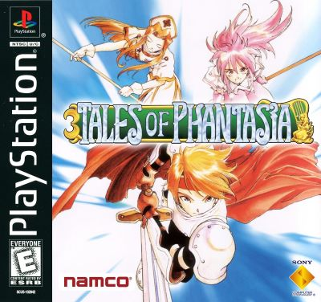
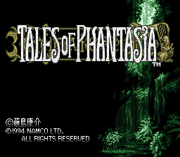
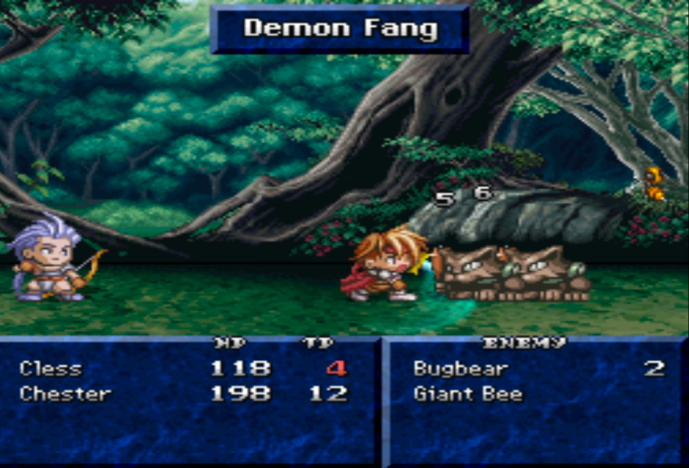

## ⏳ 테일즈 오브 판타지아 (テイルズ オブ ファンタジア)

  
  
  
  

### [테일즈 오브 판타지아 한글패치판 롬파일 다운로드](https://link-hub.net/538170/rHykjhhgHLeN)

**테일즈 오브 판타지아(テイルズ オブ ファンタジア)**는 1995년 울프 팀(Wolf Team)이 개발한 슈퍼 패미컴용 RPG로 처음 발매된 뒤, 1998년 12월 23일 남코(Namco)가 PS1으로 완전히 리메이크한 작품입니다. 지금까지도 이어지는 **테일즈 오브 시리즈**의 첫 작품이자, 실시간 액션 전투 **리니어 모션 배틀 시스템(LMBS)**을 처음 도입해 이후 시리즈 전체의 정체성을 확립한 기념비적인 타이틀입니다.

PS1판에서는 SFC 원작에서 플레이할 수 없었던 닌자 캐릭터 **스즈**가 선택 가능한 캐릭터로 추가되는 등, 단순한 그래픽 리메이크를 넘어선 콘텐츠 확장이 이루어졌습니다.

---

## 📅 출시 정보

| 항목 | 내용 |
|------|------|
| SFC 원작 발매일 | 1995년 12월 15일 (일본) |
| PS1판 발매일 | 1998년 12월 23일 (일본) |
| 개발 | 울프 팀 (Wolf Team) |
| 퍼블리셔 | 남코 (Namco) |
| 장르 | 액션 RPG |
| 플랫폼 | PlayStation |

---

## 🗂️ 테일즈 오브 시리즈 흐름

| 작품 | 연도 | 플랫폼 |
|------|------|--------|
| **테일즈 오브 판타지아** | **1995 (SFC) / 1998 (PS1 리메이크)** | **SFC / PS1** |
| 테일즈 오브 데스티니 | 1997 | PS1 |
| 테일즈 오브 이터니아 | 2000 | PS1 |
| 테일즈 오브 리버스 | 2004 | PS2 |

1편 판타지아는 시리즈 전체의 뿌리이자, 이후 모든 테일즈 오브 작품에 계승된 LMBS 전투 시스템의 원점으로 평가받습니다.

---

## 📖 스토리

### 정체불명의 전사들과 마왕 다오스

아주 오랜 과거, 정체를 알 수 없는 네 명의 전사가 악의 마법사이자 왕인 **다오스(Dhaos)**와 맞서 싸운 전설이 전해집니다. 이 전설적인 싸움의 결과는 훗날 세계의 운명을 크게 뒤바꾸는 사건으로 이어집니다.

### 소년 클레스의 여정

주인공 **클레스 알바인**은 소꿉친구 **민트 아데나드**와 함께 평화로운 마을에서 살아가던 소년이지만, 갑작스러운 사건으로 고향을 떠나 거대한 운명에 휘말리게 됩니다. 여정 중 다오스가 과거의 전설과 깊이 연관되어 있다는 사실이 드러나며 이야기가 본격적으로 전개됩니다.

### 시간을 넘나드는 모험

이야기가 진행되면서 클레스 일행은 과거와 현재, 그리고 미래를 넘나드는 **시간 여행**을 경험하게 됩니다. 각 시대마다 달라지는 세계의 모습과 사건들을 체험하며, 다오스를 둘러싼 거대한 진실에 다가갑니다.

---

## 🧑‍🤝‍🧑 주요 등장인물

| 캐릭터 | 특징 |
|------|------|
| 클레스 알바인 | 평화로운 마을 출신의 소년, 주인공 |
| 민트 아데나드 | 클레스의 소꿉친구, 치유 마법 사용 |
| 체스터 바클라이트 | 활을 사용하는 동료, 클레스의 친구 |
| 알슈 클라인 | 자유분방한 마법사 소녀 |
| 크라스 라피데스 | 노련한 소환술사 |
| 스즈 후지바야시 | 닌자, PS1판부터 선택 가능해진 캐릭터 |
| 다오스 | 전설 속 악의 마법사이자 왕, 이야기의 중심 흑막 |

---

## ⚙️ 핵심 시스템

### 리니어 모션 배틀 시스템 (LMBS)

횡스크롤 격투 게임과 액션 RPG를 결합한 독창적인 실시간 전투 시스템입니다. 메뉴를 열지 않고 버튼을 눌러 즉각적으로 공격·필살기를 발동하는 액션성이 특징으로, 이후 모든 테일즈 오브 시리즈 전투의 근간이 되었습니다.

### AI 기반 동료 조작

플레이어가 직접 조작하지 않는 동료 캐릭터는 AI가 자동으로 행동합니다. 마법 전용·방어·지원·공격 등 AI 설정을 조절해 파티 전체의 전투 스타일을 커스터마이즈할 수 있습니다.

### PS1판 신규 콘텐츠

PS1판에는 원작에 없던 신규 이벤트와 대화 시퀀스가 다수 추가되었으며, 앞서 언급한 닌자 스즈의 플레이어블화를 포함해 콘텐츠 전반이 확장되었습니다.

---

## 📜 제목을 둘러싼 비화

이 작품은 원래 울프 팀이 1994년 발매를 목표로 기획했지만, 퍼블리셔로 참여한 남코의 요구로 제목이 **테일즈 오브 판타지아**로 변경되는 등 여러 갈등을 겪으며 발매가 1995년 말로 밀렸습니다. 원안은 시나리오 작가 고탄다 요시하루가 집필한 미출간 소설 *Tale Phantasia*를 바탕으로 했으며, 이 뿌리가 지금의 시리즈명에도 고스란히 남아있습니다.

---

## 🔄 SFC 원작과 PS1판 비교

| 항목 | SFC 원작 (1995) | PS1 리메이크 (1998) |
|------|------|------|
| 그래픽 | SFC 사양의 도트 그래픽 | PS1 사양에 맞춰 전면 재작업 |
| 플레이어블 캐릭터 | 스즈 플레이 불가 | 스즈 플레이어블 캐릭터로 추가 |
| 이벤트 | 원작 이벤트만 수록 | 신규 이벤트·대화 시퀀스 추가 |
| 이후 이식 | - | PSP 풀보이스판(2006) 등으로 재출시 |

원작의 핵심 재미인 LMBS 전투와 시간 여행 서사는 그대로 유지하면서도, 콘텐츠 볼륨을 키운 덕분에 PS1판은 오랫동안 이 작품의 표준판으로 자리 잡았습니다.

---

## 💡 공략 팁

### 1. AI 설정을 전투 상황에 맞게 조정

보스전처럼 까다로운 전투에서는 동료의 AI 설정을 방어 위주로, 물량전에서는 공격 위주로 바꿔주면 훨씬 안정적으로 전투를 풀어갈 수 있습니다.

### 2. 필살기는 타이밍과 콤보가 핵심

LMBS 특유의 필살기는 적절한 콤보 이후 발동해야 위력이 극대화됩니다. 기본 공격으로 적을 묶어둔 뒤 필살기를 연계하는 습관을 들이세요.

### 3. 시대별 이벤트를 꼼꼼히 챙기기

시간 여행 요소로 인해 특정 시대에서만 진행할 수 있는 이벤트가 존재합니다. 다음 시대로 넘어가기 전에 해당 시대의 서브 이벤트를 챙겨두는 것이 좋습니다.

### 4. 스즈는 기동성을 살린 전투에 활용

PS1판에서 추가된 스즈는 빠른 기동성을 지닌 캐릭터입니다. 파티에 변화를 주고 싶다면 적극적으로 기용해보세요.

---

## 🎨 그래픽·사운드

| 항목 | 평가 |
|------|------|
| 그래픽 | SFC 원작 대비 전면 재작업된 캐릭터·필드 그래픽 |
| 연출 | 신규 이벤트가 더해진 한층 풍성한 스토리 연출 |
| 음악 | 시리즈 초기 색채를 확립한 서정적이고 웅장한 BGM |
| 사운드 | LMBS 전투의 타격감을 살리는 효과음 구성 |

---

## 🎯 추천 대상

| 대상 | 이유 |
|------|------|
| 테일즈 오브 시리즈 팬 | 시리즈 전체의 원점을 체험할 수 있는 작품 |
| 실시간 액션 전투를 좋아하는 사람 | LMBS만의 독창적인 손맛 |
| 시간 여행 서사를 즐기는 사람 | 과거·현재·미래를 넘나드는 스토리 구조 |
| PS1 명작 RPG를 찾는 사람 | SFC 원작을 한층 다듬은 완성도 높은 리메이크 |

---

## 📝 총정리

| 항목 | 내용 |
|------|------|
| 개발 | 울프 팀 (Wolf Team) |
| 퍼블리셔 | 남코 (Namco) |
| 플랫폼 | PlayStation |
| 발매 | 1998년 12월 23일 (일본) |
| 장르 | 액션 RPG |
| 강점 | 시리즈의 원점이 된 LMBS 전투, 시간 여행 서사, PS1판 신규 콘텐츠 |
| 약점 | 초기작 특유의 다소 불친절한 진행 요소 |
| 오버올 | ★★★★★ (테일즈 오브 시리즈 전체의 토대를 마련한 기념비적 작품) |

**테일즈 오브 판타지아**는 시간을 넘나드는 클레스 일행의 모험과, 지금까지도 시리즈 전투의 근간이 되는 LMBS 시스템으로 완성된 기념비적인 작품입니다. PS1판만의 신규 콘텐츠까지 더해져, 시리즈의 뿌리를 직접 체험하고 싶은 팬이라면 꼭 거쳐가야 할 출발점입니다.

---

## 🔗 참고 링크

- [테일즈 오브 판타지아 한글패치판 롬파일 다운로드](https://link-hub.net/538170/rHykjhhgHLeN)
- [테일즈 오브 판타지아 일어판 롬파일 다운로드](https://link-target.net/538170/tales-of-phatasia-ps1)
- [Tales of Phantasia — Wikipedia](https://en.wikipedia.org/wiki/Tales_of_Phantasia)
