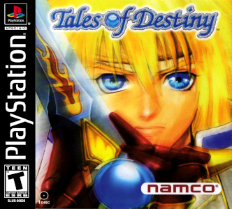
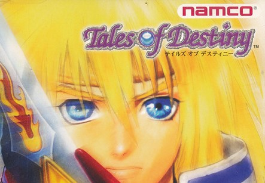
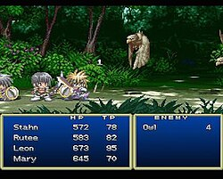

## ⚔️ 테일즈 오브 데스티니 (テイルズ オブ デスティニー)

  
  
  
  

### [테일즈 오브 데스티니 한글패치판 롬파일 다운로드](https://link-target.net/538170/PSGNbaJcCtKB)

**테일즈 오브 데스티니(テイルズ オブ デスティニー)**는 1997년 12월 23일 남코(Namco)가 발매한 PS1용 액션 RPG로, 텔레네트 재팬의 울프 팀(Wolf Team)이 개발한 **테일즈 오브 시리즈 두 번째 작품**입니다. 전작 테일즈 오브 판타지아가 슈퍼 패미컴 기반이었던 것과 달리, 이 작품은 **시리즈 최초로 3D 하드웨어를 전제로 설계**된 작품으로, PS1의 성능을 살려 한층 다듬어진 LMBS 전투와 연출을 선보였습니다.

의지를 가진 신비로운 검 **소드리안**을 둘러싼 세 주인공의 이야기와, 지금도 팬들 사이에서 인기가 높은 캐릭터 **리온 매그너스**로 잘 알려진 작품입니다.

---

## 📅 출시 정보

| 항목 | 내용 |
|------|------|
| 발매일 | 1997년 12월 23일 (일본) |
| 개발 | 텔레네트 재팬 울프 팀 (Wolf Team) |
| 퍼블리셔 | 남코 (Namco) |
| 북미 발매일 | 1998년 9월 30일 |
| 장르 | 액션 RPG |
| 플랫폼 | PlayStation |

---

## 🗂️ 테일즈 오브 시리즈 흐름

| 작품 | 연도 | 플랫폼 |
|------|------|--------|
| 테일즈 오브 판타지아 | 1995 (SFC) / 1998 (PS1) | SFC / PS1 |
| **테일즈 오브 데스티니** | **1997** | **PS1** |
| 테일즈 오브 이터니아 | 2000 | PS1 |
| 테일즈 오브 데스티니 2 | 2002 | PS2 |

전작이 시리즈의 전투 시스템을 확립했다면, 2편 데스티니는 시리즈 최초로 3D 하드웨어를 전제로 제작되어 이후 시리즈가 나아갈 그래픽·연출의 방향성을 보여준 작품입니다.

---

## 📖 스토리

### 19세 모험가, 스탄 에일런

주인공 **스탄 에일런**은 검을 다루는 19세 모험가로, 평범한 일상에서 벗어나 거대한 사건에 휘말리게 됩니다. 여정 중 의지를 가진 신비로운 검 **소드리안**과 그 소유자들을 만나며 본격적인 모험이 시작됩니다.

### 소드리안과 아타모니의 눈

세계 곳곳에는 사람처럼 생각하고 말하는 검 **소드리안**이 존재하며, 그 소유자들은 특별한 힘을 지닌 존재로 여겨집니다. 스탄 일행은 세계를 위협하는 **아타모니의 눈**의 부활을 막기 위해, 다른 소드리안의 소유자들과 함께 힘을 모으게 됩니다.

### 용병 루티와 기사 리온

여정 중 합류하는 용병 **루티 카트레아**와 고독한 분위기의 기사 **리온 매그너스**는 각자 소드리안을 소유한 인물로, 스탄과 함께 파티의 핵심을 이룹니다. 특히 리온은 복잡한 사연과 서사를 지닌 캐릭터로, 시리즈 전체에서도 유독 팬들의 애정을 받는 인물로 꼽힙니다.

---

## 🧑‍🤝‍🧑 주요 등장인물

| 캐릭터 | 특징 |
|------|------|
| 스탄 에일런 | 검을 다루는 19세 모험가, 주인공 |
| 루티 카트레아 | 용병 출신의 동료, 강인한 성격 |
| 리온 매그너스 | 세이네갈드의 젊은 기사, 대지 속성 소드리안 **샬티에** 소유 |
| 소드리안 | 의지를 가진 신비로운 검, 소유자에게 특별한 힘을 부여 |
| 아타모니의 눈 | 세계를 위협하는 봉인된 존재 |

---

## ⚙️ 핵심 시스템

### 한층 다듬어진 리니어 모션 배틀 시스템

전작 테일즈 오브 판타지아에서 처음 도입된 LMBS를 기본 틀로 유지하면서도, PS1의 3D 하드웨어 성능을 살려 조작감과 연출을 세밀하게 개선했습니다. 기본적인 전투 구조는 유사하지만, 체감되는 완성도는 한층 높아졌다는 평가를 받습니다.

### 소드리안 시스템

소유자와 대화하며 함께 성장하는 소드리안은 단순한 무기를 넘어 캐릭터성을 지닌 존재로 묘사됩니다. 전투 중 소드리안의 조언이나 반응이 더해지며 몰입도를 높이는 요소로 작용합니다.

### 시리즈 최초의 3D 전용 설계

전작까지 2D 중심이었던 시리즈 그래픽을, 이 작품부터 3D 하드웨어 PS1에 맞춰 처음부터 설계했습니다. 필드와 전투 연출 모두 한층 입체적으로 구현된 것이 특징입니다.

---

## 🔄 전작(테일즈 오브 판타지아)과의 비교

| 항목 | 테일즈 오브 판타지아 (1995/1998) | 테일즈 오브 데스티니 (1997) |
|------|------|------|
| 기반 하드웨어 | SFC 기반 (이후 PS1 리메이크) | 처음부터 PS1 3D 전용 설계 |
| 핵심 소재 | 시간 여행, 마왕 다오스 | 의지를 가진 검 소드리안 |
| 전투 시스템 | LMBS 최초 도입 | LMBS 조작감·연출 개선 |
| 인기 캐릭터 | 클레스, 민트 등 | 리온 매그너스 |

같은 LMBS 전투를 기반으로 하면서도, 데스티니는 처음부터 3D 하드웨어에 맞춰 설계되었다는 점에서 시리즈의 기술적 전환점으로 평가받습니다.

---

## 🎭 리온 매그너스라는 캐릭터

세이네갈드 왕국 역사상 최연소로 궁중 검사가 된 **리온 매그너스**는, 복잡한 사연과 고독한 분위기로 발매 당시부터 많은 팬을 매료시킨 캐릭터입니다. 훗날 2008년 발매된 디렉터스 컷판에는 리온을 주인공으로 한 별도 모드까지 추가될 정도로, 시리즈를 대표하는 인기 캐릭터로 자리매김했습니다.

---

## 💡 공략 팁

### 1. 리온은 초반에 쓰러뜨리면 특별한 분기 존재

게임 초반 특정 시점에서 리온과 맞서게 되는데, 이때 그를 쓰러뜨리면 이후 전개에 영향을 주는 특별한 분기가 발생합니다. 궁금하다면 공략 정보를 참고해 시도해보세요.

### 2. 소드리안 대화 이벤트는 꼼꼼히 챙기기

필드 곳곳에서 소드리안과 나누는 대화 이벤트는 세계관과 캐릭터 서사를 깊이 이해하는 데 중요한 요소입니다. 서두르지 말고 틈틈이 확인하는 것을 추천합니다.

### 3. 필살기는 콤보 연계 후 발동

LMBS 특유의 필살기는 기본 공격으로 적을 묶어둔 뒤 연계해야 위력이 극대화됩니다. 전작보다 다듬어진 조작감을 적극 활용해보세요.

### 4. 파티 AI 설정을 전투 상황에 맞게 조정

동료 캐릭터의 AI 행동 패턴을 공격·방어·지원 등으로 상황에 맞게 조정하면 까다로운 보스전도 한층 수월하게 풀어갈 수 있습니다.

---

## 🎨 그래픽·사운드

| 항목 | 평가 |
|------|------|
| 그래픽 | 시리즈 최초로 3D 하드웨어 전제로 설계된 입체적인 비주얼 |
| 연출 | 전작보다 매끄러워진 이벤트 신과 전투 연출 |
| 음악 | 시리즈 특유의 서정적인 멜로디를 계승한 OST |
| 사운드 | 개선된 LMBS 타격감을 살리는 효과음 구성 |

---

## 🎯 추천 대상

| 대상 | 이유 |
|------|------|
| 테일즈 오브 시리즈 팬 | 시리즈 최초의 3D 전용작이자 리온 매그너스의 원작 |
| 실시간 액션 전투를 좋아하는 사람 | 한층 다듬어진 LMBS의 손맛 |
| 의지를 가진 무기 설정을 즐기는 사람 | 소드리안이라는 독창적인 소재 |
| PS1 명작 RPG를 찾는 사람 | 시리즈 초기 명작으로 꼽히는 완성도 |

---

## 📝 총정리

| 항목 | 내용 |
|------|------|
| 개발 | 텔레네트 재팬 울프 팀 |
| 퍼블리셔 | 남코 (Namco) |
| 플랫폼 | PlayStation |
| 발매 | 1997년 12월 23일 (일본) |
| 장르 | 액션 RPG |
| 강점 | 한층 다듬어진 LMBS, 소드리안이라는 독창적 설정, 인기 캐릭터 리온 매그너스 |
| 약점 | 전작과 유사한 기본 전투 구조로 인한 신선함의 한계 |
| 오버올 | ★★★★★ (시리즈 초기를 대표하는 완성도 높은 명작) |

**테일즈 오브 데스티니**는 의지를 가진 검 소드리안을 둘러싼 스탄·루티·리온의 모험과, 시리즈 최초로 3D 하드웨어에 맞춰 다듬어진 전투 시스템으로 완성된 작품입니다. 지금도 많은 팬을 거느린 리온 매그너스라는 캐릭터를 탄생시킨 만큼, 시리즈 역사에서 빼놓을 수 없는 명작으로 꼽힙니다.

---

## 🔗 참고 링크

- [테일즈 오브 데스티니 한글패치판 롬파일 다운로드](https://link-target.net/538170/PSGNbaJcCtKB)
- [Tales of Destiny — Wikipedia](https://en.wikipedia.org/wiki/Tales_of_Destiny)
