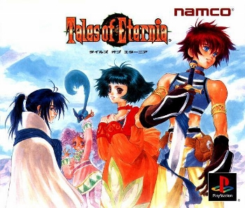
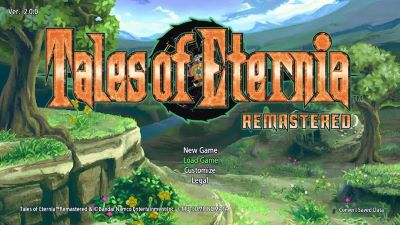
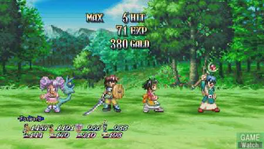
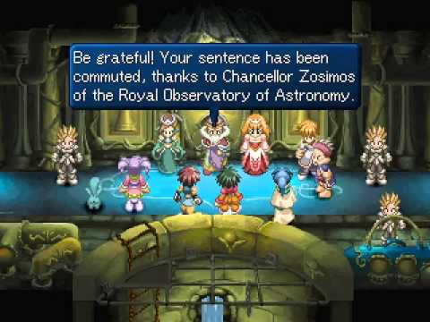

## 🌌 테일즈 오브 이터니아 (テイルズ オブ エターニア)

  
  
  
  

### [테일즈 오브 이터니아 한글패치판 롬파일 다운로드](https://direct-link.net/538170/tales-of-eternia-ps11)

**테일즈 오브 이터니아(テイルズ オブ エターニア)**는 2000년 11월 30일 남코(Namco)가 발매한 PS1용 액션 RPG로, 울프 팀(Wolf Team)이 개발한 **테일즈 오브 시리즈 세 번째 작품**입니다. 북미에서는 **테일즈 오브 데스티니 2**라는 이름으로 현지화되어 발매되었는데, 이는 일본에서 실제로 나온 정식 속편 **테일즈 오브 데스티니 2**와는 전혀 무관한 작품이라 지금까지도 혼동을 일으키는 재미있는 사례로 꼽힙니다.

충돌을 앞둔 두 개의 세계라는 독창적인 소재와, 사쿠라바 모토이가 작곡한 서정적인 음악으로 시리즈 내에서도 유독 완성도 높은 작품으로 평가받습니다.

---

## 📅 출시 정보

| 항목 | 내용 |
|------|------|
| 발매일 | 2000년 11월 30일 (일본) |
| 개발 | 울프 팀 (Wolf Team) |
| 퍼블리셔 | 남코 (Namco) |
| 디렉터 | 키쿠치 에이지 (菊池栄治) |
| 음악 | 사쿠라바 모토이 (さくらば もとい) |
| 북미 발매명 | Tales of Destiny II (2001년) |
| 장르 | 액션 RPG |
| 플랫폼 | PlayStation |

---

## 🗂️ 테일즈 오브 시리즈 흐름

| 작품 | 연도 | 플랫폼 |
|------|------|--------|
| 테일즈 오브 판타지아 | 1995 (SFC) / 1998 (PS1) | SFC / PS1 |
| 테일즈 오브 데스티니 | 1997 | PS1 |
| **테일즈 오브 이터니아** | **2000** | **PS1** |
| 테일즈 오브 데스티니 2 | 2002 | PS2 |

이터니아는 PS1 시절 테일즈 오브 시리즈의 마지막을 장식한 작품으로, 이후 PSP로도 리메이크되며 꾸준히 사랑받아온 시리즈 명작입니다.

---

## 📖 스토리

### 충돌을 앞둔 두 개의 세계

이야기의 무대는 **인페리아**와 **셀레스티아**라는 두 개의 쌍둥이 세계입니다. 거대한 혜성을 매개로 이어진 두 세계는 머지않아 서로 충돌할 운명에 처해 있으며, 이를 막기 위한 여정이 이야기의 큰 축을 이룹니다.

### 리드와 파라, 그리고 낯선 소녀

주인공 **리드 허셜**은 소꿉친구 **파라 오어스테드**와 함께 평화로운 마을에서 살아가던 평범한 청년입니다. 어느 날 두 사람은 말이 통하지 않는 신비로운 소녀 **멜디**를 만나게 되고, 그녀가 다른 세계 셀레스티아에서 왔다는 사실을 알게 되며 거대한 모험에 휘말리게 됩니다.

### 두 세계를 잇는 여정

리드 일행은 동료 **키일 자이벨**과 함께 멜디를 고향으로 돌려보내기 위해 노력하는 과정에서, 두 세계의 충돌을 막을 방법을 찾아 나섭니다. 서로 다른 문화와 가치관을 가진 두 세계가 이해와 협력을 통해 위기를 극복해나가는 과정이 이야기의 핵심 메시지로 다가옵니다.

---

## 🧑‍🤝‍🧑 주요 등장인물

| 캐릭터 | 특징 |
|------|------|
| 리드 허셜 | 인페리아 출신의 평범한 청년, 주인공 |
| 파라 오어스테드 | 리드의 소꿉친구, 격투 특화 전투 스타일 |
| 멜디 | 셀레스티아 출신의 신비로운 소녀, 처음엔 언어가 통하지 않는다 |
| 키일 자이벨 | 리드 일행에 합류하는 지적인 동료, 마법 사용 |
| 인페리아 / 셀레스티아 | 혜성으로 이어진 충돌 위기의 쌍둥이 세계 |

---

## ⚙️ 핵심 시스템

### 한층 완성된 리니어 모션 배틀 시스템

전작들을 거치며 다듬어진 LMBS가 이 작품에서 한층 완성된 형태로 구현되었습니다. 캐릭터별 개성 있는 기술과 콤보 연계가 더욱 매끄러워져, 시리즈 내에서도 전투 완성도가 높은 작품으로 평가받습니다.

### 언어 장벽을 활용한 서사 장치

멜디와의 초반 대화는 언어가 통하지 않는 설정을 활용해, 그림과 몸짓으로 의사소통하는 독특한 이벤트로 그려집니다. 시간이 지나며 서로를 이해해가는 과정이 캐릭터 서사의 중요한 축을 이룹니다.

### 요리 시스템

여정 중 재료를 모아 요리를 만들어 전투 후 회복과 버프 효과를 얻는 시스템이 존재합니다. 이후 시리즈에도 꾸준히 계승된 요소로, 이 작품에서 본격적으로 자리를 잡았습니다.

---

## 🔄 북미판 명칭을 둘러싼 혼동

북미에서는 이 작품이 **Tales of Destiny II**라는 이름으로 발매되었는데, 이는 일본에서 실제로 2002년 발매된 정식 속편 **테일즈 오브 데스티니 2**와는 전혀 다른 작품입니다. 당시 북미 퍼블리셔가 인지도 높은 전작의 이름을 차용해 마케팅한 결과로, 지금까지도 해외 팬들 사이에서 혼동을 일으키는 유명한 사례로 남아있습니다.

---

## 🔄 전작들과의 비교

| 항목 | 테일즈 오브 데스티니 (1997) | 테일즈 오브 이터니아 (2000) |
|------|------|------|
| 핵심 소재 | 의지를 가진 검 소드리안 | 충돌을 앞둔 쌍둥이 세계 |
| 전투 완성도 | LMBS 조작감 개선 | LMBS 한층 완성된 형태로 구현 |
| 신규 시스템 | - | 요리 시스템 본격 도입 |
| 시리즈 내 위치 | PS1 전환기 작품 | PS1 시대의 마지막 완성작 |

요리 시스템처럼 이 작품에서 처음 자리 잡은 요소들은 이후 시리즈 전반에 꾸준히 계승되며, 이터니아가 시리즈의 전환점 역할을 했음을 보여줍니다.

---

## 💡 공략 팁

### 1. 요리 재료는 틈틈이 채집

요리는 전투 후 상태 회복과 버프에 유용하므로, 필드를 탐험하며 재료를 꾸준히 모아두는 것이 좋습니다.

### 2. 캐릭터별 전투 스타일에 맞춘 포지션 설정

파라는 근접 격투, 키일은 마법 지원에 특화되어 있습니다. 각 캐릭터의 강점을 살리는 포지션과 AI 설정을 갖춰두면 전투가 훨씬 수월해집니다.

### 3. 멜디와의 이벤트는 놓치지 말 것

멜디와 관련된 이벤트는 스토리의 감정선을 이해하는 데 중요한 요소입니다. 서두르지 말고 충분히 즐기며 진행하세요.

### 4. 필살기 연계로 보스전 대응

한층 다듬어진 LMBS의 필살기 연계를 적극 활용하면 까다로운 보스전도 안정적으로 풀어갈 수 있습니다.

---

## 🎨 그래픽·사운드

| 항목 | 평가 |
|------|------|
| 그래픽 | PS1 말기 수준에 맞춰 다듬어진 캐릭터·필드 비주얼 |
| 연출 | 두 세계의 대비를 살린 이벤트 신 연출 |
| 음악 | 사쿠라바 모토이 작곡, 서정적이고 웅장한 OST |
| 사운드 | 완성도 높은 LMBS 타격감을 살리는 효과음 구성 |

---

## 🎯 추천 대상

| 대상 | 이유 |
|------|------|
| 테일즈 오브 시리즈 팬 | PS1 시대를 마무리하는 완성도 높은 작품 |
| 서정적인 스토리를 좋아하는 사람 | 두 세계의 충돌과 이해를 다루는 메시지 |
| 완성된 LMBS 전투를 즐기는 사람 | 시리즈 내에서도 손꼽히는 전투 완성도 |
| PS1 명작 RPG를 찾는 사람 | 이후 PSP로도 리메이크된 시리즈 명작 |

---

## 📝 총정리

| 항목 | 내용 |
|------|------|
| 개발 | 울프 팀 (Wolf Team) |
| 퍼블리셔 | 남코 (Namco) |
| 플랫폼 | PlayStation |
| 발매 | 2000년 11월 30일 (일본) |
| 장르 | 액션 RPG |
| 강점 | 완성도 높은 LMBS, 서정적인 세계관, 사쿠라바 모토이의 음악 |
| 약점 | PS1 말기작 특유의 다소 평이한 그래픽 |
| 오버올 | ★★★★★ (PS1 시대 테일즈 오브 시리즈를 마무리하는 완성작) |

**테일즈 오브 이터니아**는 충돌을 앞둔 두 세계 인페리아와 셀레스티아를 배경으로, 리드·파라·멜디·키일이 서로를 이해해가는 여정을 그린 작품입니다. 한층 완성된 LMBS 전투와 서정적인 음악까지 더해져, PS1 시대 테일즈 오브 시리즈의 정점으로 꼽히는 명작입니다.

---

## 🔗 참고 링크

- [테일즈 오브 이터니아 한글패치판 롬파일 다운로드](https://direct-link.net/538170/tales-of-eternia-ps11)
- [Tales of Eternia — Wikipedia](https://en.wikipedia.org/wiki/Tales_of_Eternia)
