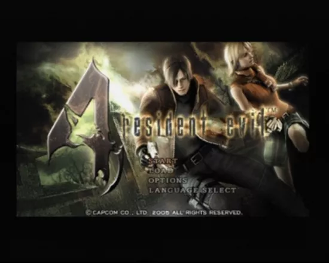
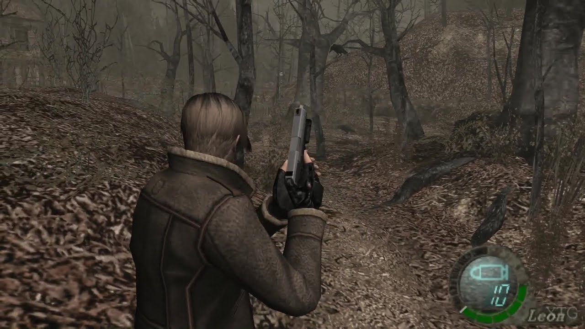
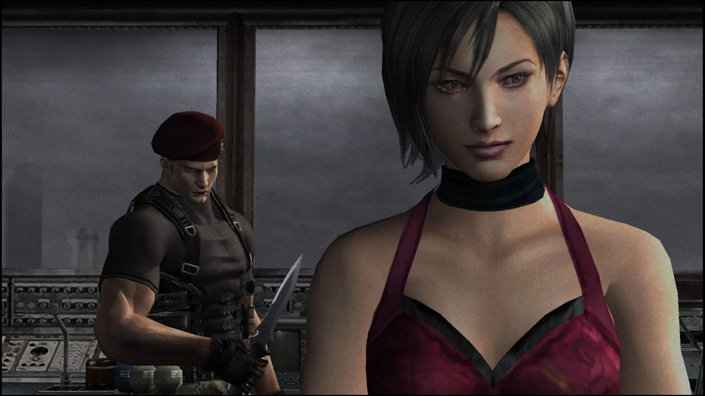

## 🧟 바이오하자드 4 (バイオハザード4)

  
  
  
  

### [바이오하자드 4 한글패치판 롬파일 다운로드](https://link-center.net/538170/OApmCZZppVho)

**바이오하자드 4(バイオハザード4)**는 2005년 1월 27일 닌텐도 게임큐브로 먼저 발매된 뒤, 같은 해 12월 1일 PS2로 이식된 캡콤의 서바이벌 호러 액션 게임입니다. 미카미 신지가 디렉터를 맡아 수년간의 개발 우여곡절을 거쳐 완성된 이 작품은, 어깨 너머 3인칭 시점과 정교해진 조작감으로 **서바이벌 호러 장르의 패러다임을 완전히 바꿔놓은 작품**으로 평가받습니다.

PS2판에는 원작 게임큐브판에 없던 **에이다 웡의 추가 시나리오**와 신규 무기, 의상 변경 요소가 더해져, 발매 당시 많은 유저들이 PS2판을 기다렸던 이유가 되기도 했습니다.

---

## 📅 출시 정보

| 항목 | 내용 |
|------|------|
| 게임큐브 원작 발매일 | 2005년 1월 27일 (일본) |
| PS2판 발매일 | 2005년 12월 1일 (일본) |
| 개발/퍼블리셔 | 캡콤 (Capcom) |
| 디렉터 | 미카미 신지 (三上真司) |
| 장르 | 서바이벌 호러 액션 |
| 플랫폼 | PlayStation 2 |

---

## 🗂️ 바이오하자드 시리즈 흐름

| 작품 | 연도 | 플랫폼 |
|------|------|--------|
| 바이오하자드 2 | 1998 | PS1 |
| 바이오하자드 3 라스트 이스케이프 | 1999 | PS1 |
| **바이오하자드 4** | **2005 (GC) / 2005 (PS2 이식)** | **GC / PS2** |
| 바이오하자드 5 | 2009 | PS3/Xbox360 |

레온이 신입 경관으로 등장했던 2편 이후, 미국 정부 요원으로 성장한 그가 다시 주인공으로 복귀하는 작품이 바로 4편입니다. 라쿤시티를 벗어나 유럽을 무대로 한 완전히 새로운 이야기를 그립니다.

---

## 📖 스토리

### 대통령의 딸을 찾아서

전직 경관이자 현재 미국 정부 요원인 **레온 S. 케네디**는, 실종된 대통령의 딸 **애슐리 그레이엄**을 구출하라는 임무를 받고 유럽의 한 외딴 마을로 향합니다. 평화로워 보이던 마을은 곧 레온을 위협하는 광기 어린 주민들로 가득 차 있다는 사실이 드러납니다.

### 라스 플라가스와 광신 집단

마을 주민들은 기존 시리즈의 좀비와는 다른, 기생 생물 **라스 플라가스**에 감염된 "가나도"들입니다. 이들을 조종하는 거대한 광신 집단의 배후에는 또 다른 거대한 음모가 숨겨져 있으며, 레온은 애슐리를 구출하는 동시에 그 진실을 파헤치게 됩니다.

### 옛 동료, 에이다 웡의 재등장

여정 중 레온은 2편에서 인연이 있던 신비로운 여성 **에이다 웡**과 다시 마주하게 됩니다. 그녀의 목적과 정체는 이야기 후반까지 베일에 싸여 있으며, PS2판에서는 그녀의 시점으로 진행되는 별도의 시나리오까지 체험할 수 있습니다.

---

## 🧑‍🤝‍🧑 주요 등장인물

| 캐릭터 | 특징 |
|------|------|
| 레온 S. 케네디 | 미국 정부 요원, 주인공 |
| 애슐리 그레이엄 | 대통령의 딸, 구출 대상이자 동행 캐릭터 |
| 에이다 웡 | 신비로운 여성, PS2판 추가 시나리오의 주인공 |
| 가나도 | 라스 플라가스에 감염된 마을 주민들 |
| 오스문드 사들러 | 마을을 지배하는 광신 집단의 지도자 |

---

## ⚙️ 핵심 시스템

### 어깨 너머 3인칭 시점

고정 카메라 중심이었던 전작들과 달리, 캐릭터의 어깨 너머로 바라보는 **3인칭 시점**을 전면 도입했습니다. 조준과 이동의 자유도가 크게 높아지며, 이후 수많은 액션 게임에 영향을 미친 혁신적인 변화로 평가받습니다.

### 정교해진 전투와 QTE

총기 조준과 근접 공격을 결합한 전투와, 상황에 따라 반응해야 하는 퀵타임 이벤트(QTE)가 전투와 이벤트 곳곳에 배치되어 긴박감을 더합니다.

### 애슐리 동행 시스템

구출한 애슐리는 레온과 함께 이동하며, 그녀를 보호하고 지시를 내리는 요소가 게임 플레이에 반영됩니다. 애슐리의 생존 여부가 직접적인 게임 오버 조건으로 이어지는 점도 특징입니다.

### PS2판 신규 — 세퍼레이트 웨이즈

PS2판에는 에이다 웡의 시점에서 벌어지는 별도의 챕터 **세퍼레이트 웨이즈**가 추가되어, 본편에서 다뤄지지 않은 사건의 이면을 확인할 수 있습니다. 또한 신규 무기와 레온·애슐리의 추가 의상도 포함되었습니다.

---

## 🔄 게임큐브 원작과 PS2판 비교

| 항목 | 게임큐브 원작 (2005.01) | PS2판 (2005.12) |
|------|------|------|
| 추가 시나리오 | 없음 | 세퍼레이트 웨이즈(에이다 웡 시점) 수록 |
| 무기 | 기본 무기 구성 | 신규 무기 추가 |
| 의상 | 기본 의상 | 레온·애슐리 추가 의상 수록 |
| 그래픽 | 당시 최상급 비주얼 | PS2 사양에 맞춘 소폭 조정 |

원작의 완성도를 해치지 않으면서도 풍부한 추가 콘텐츠를 더한 덕분에, PS2판은 발매 당시 많은 유저들에게 "기다릴 가치가 있는 이식판"으로 평가받았습니다.

---

## 🎮 장르를 바꾼 영향력

바이오하자드 4가 선보인 어깨 너머 시점과 정교한 사격 전투는, 이후 수많은 액션 게임과 서바이벌 호러 게임에 직접적인 영향을 미쳤습니다. 발매 20년이 지난 지금까지도 "현대 서바이벌 호러의 기준을 세운 작품"으로 꾸준히 언급되는 이유입니다.

---

## 💡 공략 팁

### 1. 헤드샷과 다운 공격을 적극 활용

가나도의 머리나 다리에 조준 사격을 가하면 비틀거리는 틈에 근접 공격으로 추가 데미지를 줄 수 있습니다. 탄환을 아끼면서 효율적으로 적을 처리하는 핵심 전략입니다.

### 2. 애슐리의 안전을 최우선으로

애슐리가 적에게 붙잡히면 즉시 구출해야 합니다. 전투 중에는 그녀를 안전한 위치에 대기시키는 지시를 적극 활용하세요.

### 3. 자원 관리와 상인 활용

여정 중 만나는 신비로운 상인에게 탄환과 재료를 판매하고 무기를 강화할 수 있습니다. 불필요한 아이템은 과감히 팔아 필요한 장비에 투자하세요.

### 4. QTE는 미리 마음의 준비

곳곳에 배치된 퀵타임 이벤트는 반응 속도가 중요합니다. 긴장되는 연출이 나올 때는 컨트롤러를 놓지 말고 집중하세요.

### 5. 세퍼레이트 웨이즈로 이야기의 이면 체험

본편을 클리어했다면 PS2판 전용 추가 시나리오 세퍼레이트 웨이즈를 꼭 플레이해보세요. 에이다 웡의 시점에서 본편의 사건을 다시 체험하는 재미가 있습니다.

---

## 🎨 그래픽·사운드

| 항목 | 평가 |
|------|------|
| 그래픽 | PS2 사양에 맞춰 조정되었음에도 뛰어난 캐릭터·배경 비주얼 |
| 연출 | 영화적인 카메라 워크와 긴박감 넘치는 이벤트 신 |
| 음악 | 긴장감을 극대화하는 전투·탐험 BGM |
| 사운드 | 가나도의 위협적인 음성과 환경음 디자인 |

---

## 🎯 추천 대상

| 대상 | 이유 |
|------|------|
| 서바이벌 호러 액션을 좋아하는 사람 | 장르의 패러다임을 바꾼 전투와 연출 |
| 바이오하자드 시리즈 팬 | 시리즈 최고 명작으로 꼽히는 완성도 |
| 추가 콘텐츠를 원하는 유저 | PS2판 전용 세퍼레이트 웨이즈와 신규 무기 |
| 긴박한 스토리 전개를 즐기는 사람 | 레온과 애슐리를 둘러싼 몰입감 있는 서사 |

---

## 📝 총정리

| 항목 | 내용 |
|------|------|
| 개발/퍼블리셔 | 캡콤 (Capcom) |
| 플랫폼 | PlayStation 2 |
| 발매 | 2005년 12월 1일 (일본, PS2판) |
| 장르 | 서바이벌 호러 액션 |
| 강점 | 혁신적인 3인칭 시점, 정교한 전투, PS2판 전용 추가 콘텐츠 |
| 약점 | 게임큐브 원작보다 소폭 조정된 그래픽 퀄리티 |
| 오버올 | ★★★★★ (서바이벌 호러 장르의 패러다임을 바꾼 시리즈 최고 명작) |

**바이오하자드 4**는 유럽의 외딴 마을에서 벌어지는 레온의 사투를 통해, 어깨 너머 시점과 정교한 전투로 서바이벌 호러 장르 전체의 방향을 바꿔놓은 작품입니다. PS2판 전용 세퍼레이트 웨이즈까지 더해져, 지금까지도 많은 유저들에게 시리즈 최고작으로 꼽히는 명작입니다.

---

## 🔗 참고 링크

- [바이오하자드 4 한글패치판 롬파일 다운로드](https://link-center.net/538170/OApmCZZppVho)
- [Resident Evil 4 — Wikipedia](https://en.wikipedia.org/wiki/Resident_Evil_4)
