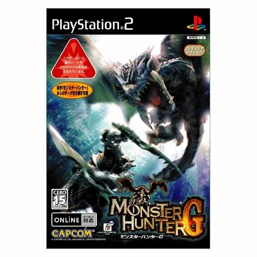
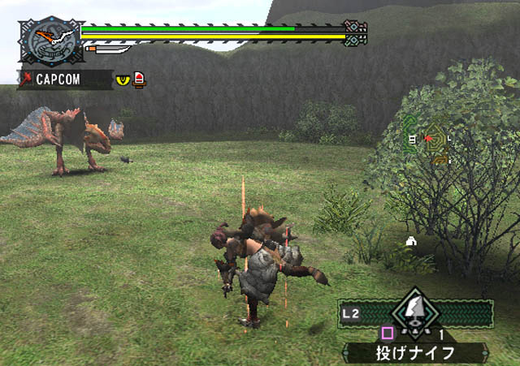
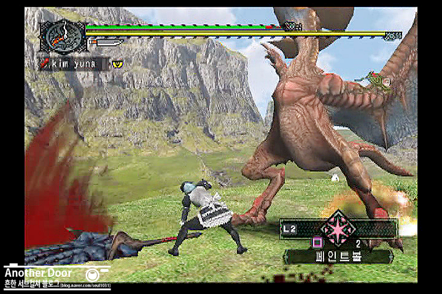

## 🐗 몬스터헌터 G (モンスターハンターG)

  
  
  
  

### [몬스터헌터 G 한글판 롬파일 다운로드](https://link-hub.net/538170/monster-hunter-g-ps2)
### [몬스터헌터 플러스 한글패치 롬파일 다운로드](https://link-target.net/538170/ps2-monster-hunter-plus)

**몬스터헌터 G(モンスターハンターG)**는 2005년 1월 20일 캡콤이 발매한 PS2용 헌팅 액션 게임으로, 2004년 발매된 **몬스터헌터** 1편을 대폭 강화한 업그레이드판입니다. 단순한 염가판에 그치지 않고 신규 무기와 고난도 콘텐츠를 더한 본격적인 확장판으로 기획되면서, 이후 PSP로 이식된 **몬스터헌터 포터블** 시리즈의 직접적인 토대가 된 작품입니다.

북미판 로컬라이징 스태프가 가져온 **쌍검**의 모션 아이디어가 이 작품을 단순 염가판이 아닌 업그레이드판으로 기획하게 된 계기가 되었다는 일화로도 잘 알려져 있습니다.

---

## 📅 출시 정보

| 항목 | 내용 |
|------|------|
| 기반 작품 | 몬스터헌터 (PS2, 2004년) |
| 발매일 | 2005년 1월 20일 (일본) |
| 개발/퍼블리셔 | 캡콤 (Capcom) |
| 가격 | 4,990엔 (통상판) |
| 장르 | 헌팅 액션 |
| 플랫폼 | PlayStation 2 |

---

## 🗂️ 몬스터헌터 시리즈 흐름

| 작품 | 연도 | 플랫폼 |
|------|------|--------|
| 몬스터헌터 | 2004 | PS2 |
| **몬스터헌터 G** | **2005** | **PS2** |
| 몬스터헌터 포터블 | 2005 | PSP |
| 몬스터헌터 포터블 2nd | 2007 | PSP |

G는 PS2판 1편을 강화한 업그레이드판이자, 같은 해 말 PSP로 이식된 몬스터헌터 포터블의 기반이 된 작품으로, 시리즈가 거치형에서 휴대용으로 영역을 넓히는 데 핵심적인 역할을 했습니다.

---

## 📖 세계관과 헌터의 삶

### 거대한 몬스터와 공존하는 세계

몬스터헌터 시리즈의 무대는 거대한 몬스터들이 살아가는 세계이며, 플레이어는 길드에 소속된 **헌터**가 되어 의뢰를 받아 몬스터를 사냥합니다. 정형화된 스토리보다, 소재를 모아 장비를 제작하고 더 강한 몬스터에 도전하는 **생활 사이클** 자체가 게임의 핵심입니다.

### 전작의 강화판이라는 위치

G는 완전히 새로운 이야기를 다루는 속편이 아니라, 전작 1편의 세계와 시스템을 그대로 가져오면서 콘텐츠를 대폭 확장한 작품입니다. 전작을 경험한 유저라면 익숙한 틀 안에서 새로워진 도전을 즐길 수 있습니다.

---

## 🧑‍🤝‍🧑 신규 몬스터

| 몬스터 | 특징 |
|------|------|
| 아종(亜種) 몬스터 | 기존 몬스터의 색상·속성이 다른 강화 개체, G에서 최초 등장 |
| 희소종(希少種) 몬스터 | 아종보다 한층 희귀하고 강력한 개체 |
| 기존 간판 몬스터 | 리오레우스·리오레이아 등 1편의 몬스터 전체 계승 |

---

## ⚙️ 핵심 시스템

### G급(G級) 퀘스트

온라인 모드에 추가된 고난도 퀘스트인 **G급 퀘스트**는, 전작보다 훨씬 강력한 몬스터가 등장해 엔드 콘텐츠를 찾는 유저에게 진짜 도전 거리를 제공합니다.

### 신규 무기 — 쌍검(双剣)

이 작품에서 처음 추가된 무기 타입 **쌍검**은, 빠른 연속 공격과 회피 기동을 앞세운 독특한 조작감으로 이후 시리즈의 대표 무기 타입 중 하나로 자리 잡았습니다.

### 방어구 스킬 시스템 개편

기존에는 특정 방어구 조합으로만 발동하던 스킬이, G부터는 각 방어구가 가진 **스킬 포인트의 합산**에 따라 발동하도록 시스템이 변경되었습니다. 훨씬 자유로운 장비 조합이 가능해진 핵심 개편입니다.

### 훈련소(訓練所)

신규 모드로 추가된 **훈련소**에서는 실전 사냥에 나서기 전 기본 조작과 무기별 특성을 익힐 수 있어, 입문자의 진입 장벽을 낮추는 데 도움을 줍니다.

---

## 🔄 전작(몬스터헌터)과 비교

| 항목 | 몬스터헌터 (2004) | 몬스터헌터 G (2005) |
|------|------|------|
| 무기 종류 | 기존 무기 타입 | 쌍검 신규 추가 |
| 퀘스트 등급 | 상급까지 | G급 퀘스트 신규 추가 |
| 몬스터 | 기존 종 | 아종·희소종 추가 |
| 방어구 스킬 | 특정 조합 필요 | 스킬 포인트 합산 방식으로 개편 |
| 신규 모드 | - | 훈련소 추가 |

단순한 염가 재발매가 아니라, 무기 체계와 장비 시스템까지 손을 댄 본격적인 업그레이드판으로 기획된 점이 이 작품을 특별하게 만드는 지점입니다.

---

## 🎮 포터블 시리즈로 이어진 유산

몬스터헌터 G에서 확립된 G급 퀘스트, 쌍검, 아종·희소종이라는 세 가지 축은 같은 해 말 발매된 몬스터헌터 포터블을 통해 PSP로 그대로 계승되었습니다. 이후 2nd, 2nd G로 이어지며 PSP 최고 인기 시리즈로 성장한 흐름의 출발점이 바로 이 작품인 셈입니다.

---

## 💡 공략 팁

### 1. 훈련소에서 무기 조작부터 익히기

여러 무기 타입을 처음 접한다면 훈련소에서 기본 조작을 충분히 연습한 뒤 실전에 나서는 것이 좋습니다.

### 2. 방어구 스킬 포인트 조합을 적극 활용

스킬 발동 조건이 포인트 합산으로 바뀌었으므로, 서로 다른 방어구를 조합해 원하는 스킬 조합을 자유롭게 구성해보세요.

### 3. 아종·희소종은 기존 몬스터보다 신중하게

같은 종이라도 아종·희소종은 패턴과 공격력이 강화되어 있습니다. 기존 장비로 무리하게 도전하기보다 충분히 보강한 뒤 맞서는 것이 안정적입니다.

### 4. 쌍검은 회피 기동을 살려 운용

쌍검은 느린 무기들과 달리 기동성이 뛰어납니다. 지속적으로 움직이며 약점 부위를 파고드는 운용이 효율적입니다.

### 5. G급 퀘스트는 장비를 충분히 갖춘 뒤 도전

G급 퀘스트의 몬스터는 기존 등급보다 훨씬 강력합니다. 상급 장비를 갖추고 동료와 함께 도전하는 것을 권장합니다.

---

## 🎨 그래픽·사운드

| 항목 | 평가 |
|------|------|
| 그래픽 | 전작을 계승한 PS2 사양의 몬스터·필드 비주얼 |
| 연출 | 거대 몬스터와의 긴박한 사냥 액션 연출 |
| 음악 | 시리즈 초기부터 이어진 웅장한 테마곡 |
| 사운드 | 신규 무기 쌍검의 경쾌한 타격감을 살리는 효과음 |

---

## 🎯 추천 대상

| 대상 | 이유 |
|------|------|
| 헌팅 액션 장르를 좋아하는 사람 | G급 퀘스트 등 대폭 확장된 엔드 콘텐츠 |
| 전작을 플레이한 유저 | 익숙한 세계에 더해진 신규 무기·시스템 |
| 몬스터헌터 시리즈의 역사를 궁금해하는 사람 | 포터블 시리즈로 이어지는 중요한 전환점 |
| 다양한 무기를 시험해보고 싶은 사람 | 쌍검 등 새로운 전투 스타일 체험 |

---

## 📝 총정리

| 항목 | 내용 |
|------|------|
| 개발/퍼블리셔 | 캡콤 (Capcom) |
| 플랫폼 | PlayStation 2 |
| 발매 | 2005년 1월 20일 (일본) |
| 장르 | 헌팅 액션 |
| 강점 | G급 퀘스트, 신규 무기 쌍검, 자유로운 방어구 스킬 조합 |
| 약점 | 완전히 새로운 콘텐츠보다는 전작 기반의 확장에 머무름 |
| 오버올 | ★★★★☆ (포터블 시리즈의 토대를 마련한 의미 있는 강화판) |

**몬스터헌터 G**는 전작의 세계와 틀을 유지하면서도 G급 퀘스트와 쌍검, 아종·희소종 몬스터 등 풍부한 신규 콘텐츠를 더한 업그레이드판입니다. 같은 해 PSP로 이식되며 시리즈를 휴대용 플랫폼으로 확장시킨 토대가 되었다는 점에서, 시리즈 역사에 중요한 한 획을 그은 작품으로 평가받습니다.

---

## 🔗 참고 링크

- [몬스터헌터 G 한글판 롬파일 다운로드](https://link-hub.net/538170/monster-hunter-g-ps2)
- [몬스터헌터 플러스 한글패치 롬파일 다운로드](https://link-target.net/538170/ps2-monster-hunter-plus)
- [Monster Hunter G — Wikipedia](https://en.wikipedia.org/wiki/Monster_Hunter_(video_game))
