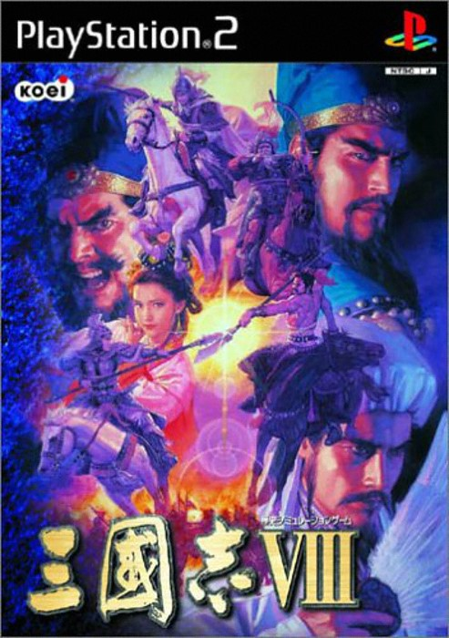
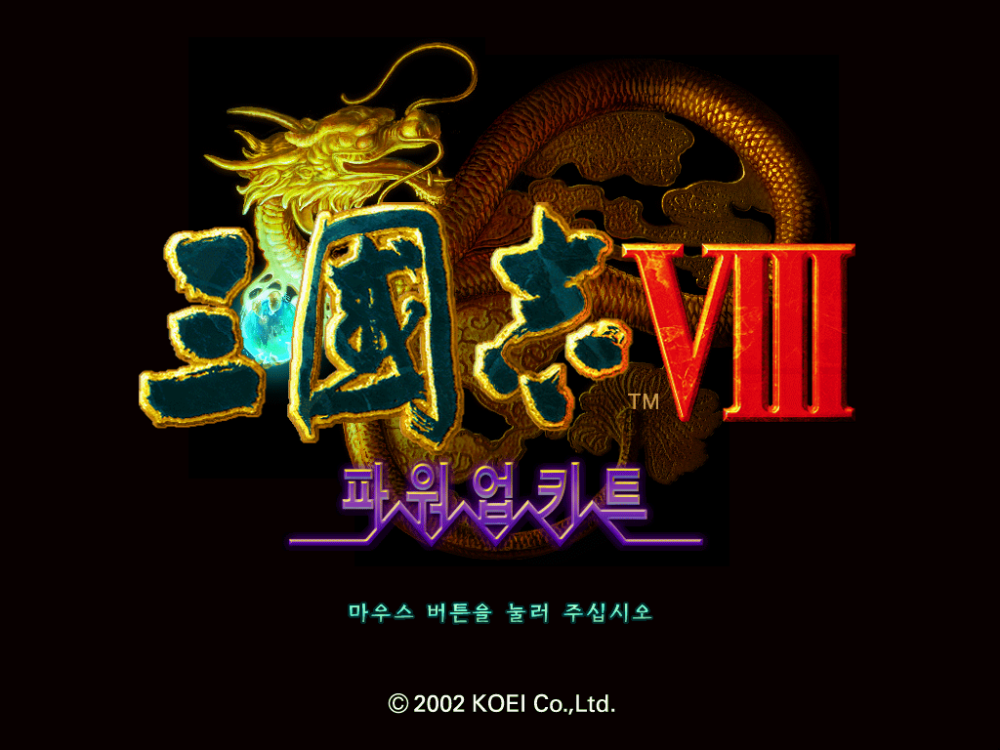
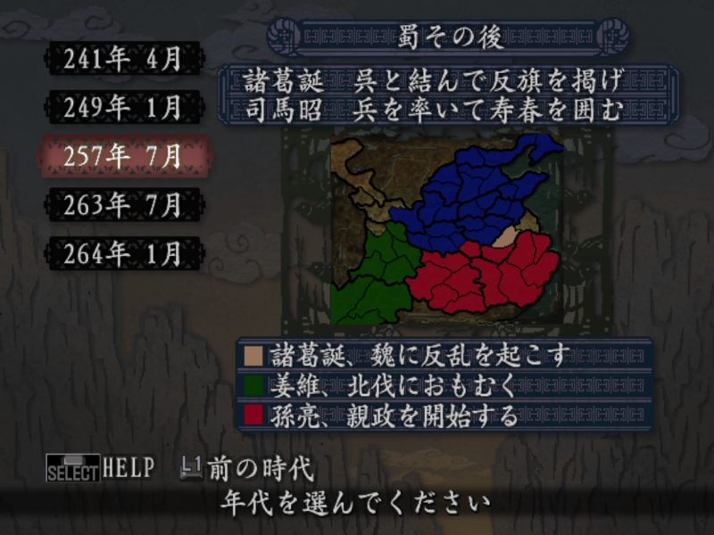
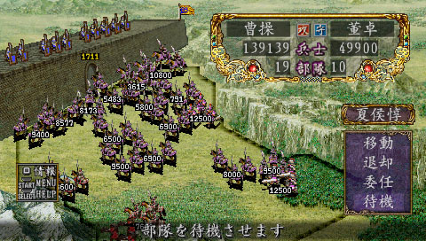

## 🏯 삼국지 8 with 파워업킷 (三國志VIII with パワーアップキット)

  
  
  
  

### [삼국지 8 PK 한글패치판 롬파일 다운로드](https://link-center.net/538170/wASBpmbwPRTN)

**삼국지 VIII(三國志VIII)**는 2001년 코에이(Koei)가 PC로 처음 발매한 턴제 전략 시뮬레이션 게임으로, 2002년 1월 24일 PS2로 이식되었습니다. 추가 콘텐츠를 더한 강화판 **파워업킷(PK)**에는 신규 시나리오 3개와 새로운 게임 모드, 개선된 AI와 에디터가 포함되어, 본편을 모두 즐긴 유저에게도 새로운 재미를 제공하는 완성판으로 자리 잡았습니다.

군주가 아닌 **한 명의 무장**으로 시작해 자신만의 인생을 개척해 나간다는 독창적인 컨셉으로, 전통적인 삼국지 시리즈와는 또 다른 매력을 지닌 작품입니다.

---

## 📅 출시 정보

| 항목 | 내용 |
|------|------|
| PC 원작 발매일 | 2001년 6월 29일 (일본) |
| PS2판 발매일 | 2002년 1월 24일 (일본) |
| 개발/퍼블리셔 | 코에이 (Koei) |
| 장르 | 턴제 전략 시뮬레이션 |
| 플랫폼 | PlayStation 2 |

---

## 🗂️ 삼국지 시리즈 흐름

| 작품 | 연도 | 플랫폼 |
|------|------|--------|
| 삼국지 7 | 2000 | PC/PS2 |
| **삼국지 8 with 파워업킷** | **2001 (PC) / 2002 (PS2)** | **PC/PS2** |
| 삼국지 9 | 2003 | PC/PS2 |
| 삼국지 11 | 2006 | PC/PS2 |

8편은 시리즈 역사상 유독 개인 무장 중심의 인생 시뮬레이션 요소를 강하게 내세운 작품으로, 군주 중심의 전통적인 삼국지 시리즈와는 결이 다른 독자적인 자리를 차지하고 있습니다.

---

## 📖 세계관과 플레이 방식

### 군주가 아닌 한 명의 무장으로

이 작품의 가장 큰 특징은 플레이어가 **군주가 아닌 한 명의 무장**을 조작한다는 점입니다. 역사 속 실존 인물로 시작하거나, 직접 만든 캐릭터로 중국 전역을 무대로 한 입신양명의 여정을 그려나갑니다.

### 세대를 잇는 인생 시뮬레이션

조작하는 무장은 나이가 들며 노쇠하고, 끝내 세상을 떠나기도 합니다. 결혼과 자녀를 통해 혈통을 이어가며, 자신이 키운 자식에게 능력치와 유산을 물려줄 수 있는 독특한 **세대 계승 시스템**이 존재합니다.

### 파워업킷이 더한 콘텐츠

PK판에는 신규 시나리오 3종과 새로운 게임 모드가 추가되었으며, 적 AI와 시나리오 에디터도 한층 개선되었습니다. 기존 본편의 틀을 유지하면서도 재플레이 가치를 크게 끌어올린 확장판입니다.

---

## 🧑‍🤝‍🧑 주요 세력과 인물

| 요소 | 특징 |
|------|------|
| 역사 속 실존 무장 | 유비, 조조, 손권 등 삼국지 주요 인물로 플레이 가능 |
| 창작 무장 | 플레이어가 직접 외모와 능력치를 설정해 만드는 캐릭터 |
| 군주 세력 | 플레이어가 소속되거나 맞서는 각 지역의 군주들 |
| 후손 캐릭터 | 세대 계승을 통해 등장하는 자녀 세대 캐릭터 |

---

## ⚙️ 핵심 시스템

### 능력치 성장과 학습

무장은 통솔·무력·지력·정치 등 능력치를 가지고 있으며, 다른 무장과의 교류나 서적 학습을 통해 꾸준히 성장시킬 수 있습니다. 시간이 흐를수록 변화하는 캐릭터의 성장 곡선이 게임의 핵심 재미입니다.

### 개인 전투와 계략

전장에서는 직접 지휘관으로 전투를 수행하며, 계략과 모략을 통해 적을 함정에 빠뜨리는 전략적 플레이도 가능합니다. 단순한 물량전이 아니라 개인의 능력과 지혜가 승패를 가르는 구조입니다.

### 사관(仕官)과 독립

마음에 드는 군주를 섬기며 공을 세워 입신하거나, 충분한 세력을 모아 스스로 독립해 군주가 되는 길도 선택할 수 있습니다. 한 명의 무장으로 시작해 어디까지 올라갈 수 있는지가 이 작품의 묘미입니다.

---

## 🔄 전통적인 삼국지 시리즈와의 차이

| 항목 | 전통적인 삼국지 시리즈 | 삼국지 8 |
|------|------|------|
| 조작 대상 | 군주(세력 전체) | 한 명의 무장 개인 |
| 플레이 목표 | 세력 확장과 천하통일 | 입신양명과 세대 계승 |
| 캐릭터의 운명 | 세력 중심으로 간접 묘사 | 노화·결혼·사망까지 직접 체험 |
| 전투 방식 | 대규모 전략 전투 | 개인 지휘와 계략 중심 |

같은 삼국지 세계관을 다루면서도 완전히 다른 시점에서 이야기를 풀어낸다는 점에서, 8편은 시리즈 팬들 사이에서도 유독 독특한 작품으로 기억됩니다.

---

## 🧩 파워업킷이 더한 변화

PK판은 단순히 난이도나 밸런스를 조정하는 수준을 넘어, 완전히 새로운 시나리오 3종을 통해 전혀 다른 시작점에서 게임을 즐길 수 있게 해주었습니다. 또한 개선된 적 AI는 기존 본편보다 한층 치열한 공방전을 만들어냈고, 유저가 직접 시나리오를 제작할 수 있는 에디터 기능까지 강화되어 커뮤니티 차원의 재플레이 가치도 크게 높아졌습니다.

---

## 🏛️ 시리즈 내에서의 평가

삼국지 8은 발매 당시부터 "군주가 아닌 개인의 삶을 산다"는 컨셉으로 호불호가 갈렸지만, 특유의 세대 계승 시스템과 인생 시뮬레이션적 재미는 지금까지도 독자적인 팬층을 형성하는 요인이 되었습니다. 이후 시리즈에서도 완전히 같은 방식은 재현되지 않아, 8편만의 개성으로 남아있습니다.

---

## 💡 공략 팁

### 1. 초반엔 유력 군주 밑에서 경험 쌓기

처음부터 독립을 노리기보다, 유력한 군주를 섬기며 공적을 쌓고 능력치를 성장시키는 것이 안정적인 시작입니다.

### 2. 학습과 교류로 능력치 꾸준히 관리

전투만큼 중요한 것이 평상시의 학습과 교류입니다. 틈틈이 능력치를 관리해두면 결정적인 순간에 큰 도움이 됩니다.

### 3. 혼인과 세대 계승을 적극 활용

좋은 배우자를 만나 혼인하고 자녀를 낳아두면, 캐릭터가 노쇠했을 때 후계자로 자연스럽게 이어갈 수 있습니다. 미리 준비해두는 것이 장기 플레이의 핵심입니다.

### 4. 신규 시나리오로 다양한 체험

파워업킷이 추가한 신규 시나리오는 기존과 다른 상황에서 시작하는 재미를 제공합니다. 본편을 충분히 즐겼다면 새로운 시나리오에 도전해보세요.

---

## 🎨 그래픽·사운드

| 항목 | 평가 |
|------|------|
| 그래픽 | PS2 사양에 맞춰 조정된 전통적인 삼국지 비주얼 |
| 연출 | 개인 무장의 일생을 따라가는 차분한 이벤트 연출 |
| 음악 | 중국풍 테마를 살린 시리즈 특유의 BGM |
| 사운드 | 전투와 계략 장면을 살리는 효과음 구성 |

---

## 🎯 추천 대상

| 대상 | 이유 |
|------|------|
| 삼국지 시리즈 팬 | 군주 중심이 아닌 개인 무장 시점의 독자적인 재미 |
| 인생 시뮬레이션을 좋아하는 사람 | 세대를 잇는 성장과 계승 시스템 |
| 전략 시뮬레이션 애호가 | 계략과 모략이 어우러진 깊이 있는 전투 |
| PS2 명작 전략 게임을 찾는 사람 | 파워업킷으로 완성된 풍부한 콘텐츠 |

---

## 📝 총정리

| 항목 | 내용 |
|------|------|
| 개발/퍼블리셔 | 코에이 (Koei) |
| 플랫폼 | PlayStation 2 |
| 발매 | 2002년 1월 24일 (일본) |
| 장르 | 턴제 전략 시뮬레이션 |
| 강점 | 개인 무장 중심의 독창적인 인생 시뮬레이션, 파워업킷의 풍부한 콘텐츠 |
| 약점 | 전통적인 군주 시점 삼국지를 기대한 유저에겐 낯선 구조 |
| 오버올 | ★★★★☆ (삼국지 시리즈 내에서도 독자적인 색깔을 지닌 수작) |

**삼국지 8 with 파워업킷**은 군주가 아닌 한 명의 무장으로 시작해 세대를 이어가는 독창적인 인생 시뮬레이션으로, 전통적인 삼국지 시리즈와는 또 다른 매력을 보여주는 작품입니다. 파워업킷의 신규 시나리오와 개선된 콘텐츠까지 더해져, 시리즈 팬이라면 한 번쯤은 체험해볼 만한 개성 있는 수작입니다.

---

## 🔗 참고 링크

- [삼국지 8 PK 한글패치판 롬파일 다운로드](https://link-center.net/538170/wASBpmbwPRTN)
- [삼국지 8 PK 일어판 롬파일 다운로드](https://1024terabox.com/s/1A3tFJ1Jlf9qxk-YO_J1Crw)
- [Romance of the Three Kingdoms VIII — Wikipedia](https://en.wikipedia.org/wiki/Romance_of_the_Three_Kingdoms_VIII)
