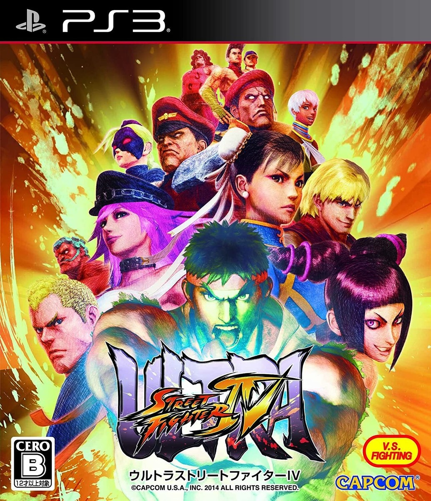
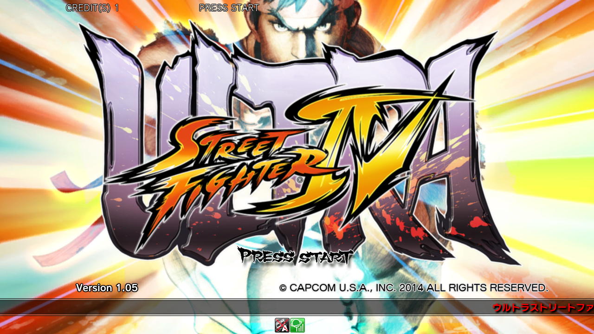
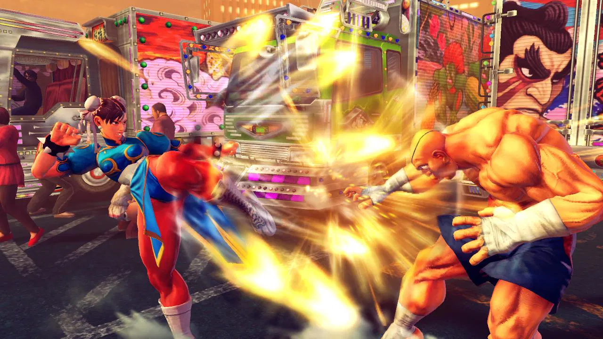
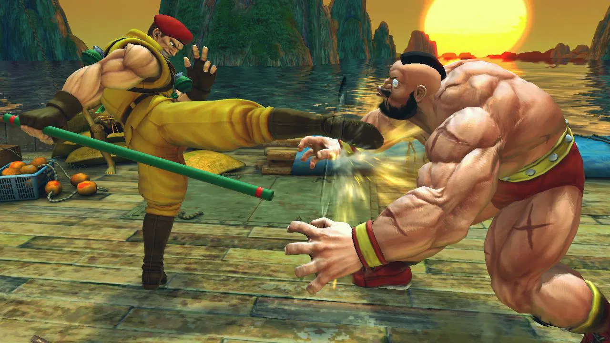

## 👊 울트라 스트리트 파이터 4 (ウルトラストリートファイターIV)

  
  
  
  

### [울트라 스트리트 파이터 4 한글판 롬파일 다운로드](https://link-center.net/538170/kbqLDAGIwW3V)

**울트라 스트리트 파이터 IV(ウルトラストリートファイターIV)**는 2014년 캡콤(Capcom)이 발매한 PS3용 대전 액션 게임으로, 2008년 첫 등장한 **스트리트 파이터 4** 시리즈의 네 번째이자 마지막 강화판입니다. 기존 **슈퍼 스트리트 파이터 4 아케이드 에디션**을 기반으로 신규 캐릭터 5인과 추가 스테이지, 새로운 시스템을 더해, 시리즈 전체를 통틀어 **가장 완성된 최종판**으로 자리매김한 작품입니다.

기존 소유자를 위한 디지털 업그레이드와 신규 구매자를 위한 패키지판을 모두 지원해, 시리즈를 꾸준히 즐겨온 유저와 새로 입문하는 유저 모두를 아우른 작품이기도 합니다.

---

## 📅 출시 정보

| 항목 | 내용 |
|------|------|
| 디지털 업그레이드 발매일 | 2014년 6월 3일 (PS3, 북미 기준) |
| 패키지/전체 디지털판 발매일 | 2014년 8월 5일 (PS3, 북미 기준) |
| 개발/퍼블리셔 | 캡콤 (Capcom) |
| 기반 작품 | 슈퍼 스트리트 파이터 4 아케이드 에디션 |
| 장르 | 대전 액션 (격투 게임) |
| 플랫폼 | PlayStation 3 |

---

## 🗂️ 스트리트 파이터 4 시리즈 흐름

| 작품 | 연도 | 플랫폼 |
|------|------|--------|
| 스트리트 파이터 4 | 2009 | PS3 |
| 슈퍼 스트리트 파이터 4 | 2010 | PS3 |
| 슈퍼 스트리트 파이터 4 아케이드 에디션 | 2011 | PS3 |
| **울트라 스트리트 파이터 4** | **2014** | **PS3** |

4편은 2009년 첫 발매 이후 여러 차례 강화판을 거치며 꾸준히 밸런스와 콘텐츠를 다듬어온 시리즈로, 울트라판은 그 긴 업데이트 역사의 마지막 종착점에 해당합니다.

---

## 📖 작품 소개

### 세계 각지의 격투가들이 모이다

스트리트 파이터 시리즈는 전 세계 각지의 개성 넘치는 격투가들이 저마다의 사연을 안고 대결을 벌이는 토너먼트형 세계관을 공유합니다. 울트라판 역시 기존 캐릭터들의 이야기를 그대로 계승하며, 신규 캐릭터들의 서사를 더해 세계관을 한층 풍성하게 만들었습니다.

### 팬 피드백을 반영한 최종 밸런스

캡콤은 이 작품을 개발하며 그동안 쌓인 팬들의 피드백을 적극적으로 반영해 캐릭터 밸런스를 조정했다고 밝혔습니다. 오랜 시간 다듬어진 끝에 나온 밸런스는 시리즈 내에서도 가장 안정적이라는 평가를 받습니다.

---

## 🧑‍🤝‍🧑 신규 캐릭터

| 캐릭터 | 특징 |
|------|------|
| 포이즌 (Poison) | 파이널 파이트 출신의 채찍을 사용하는 격투가 |
| 휴고 (Hugo) | 거대한 체구의 레슬링 스타일 격투가 |
| 엘레나 (Elena) | 아프리카 출신의 카포에라 격투가 |
| 로렌토 (Rolento) | 군용 장비를 활용하는 전술형 격투가 |
| 데카프레 (Decapre) | 캐미 계열의 신규 캐릭터, 총 44명 로스터 완성 |

---

## ⚙️ 핵심 시스템

### 듀얼 얼티밋 콤보

한 경기에서 두 개의 얼티밋 콤보를 함께 선택해 사용할 수 있는 **듀얼 얼티밋 콤보** 시스템이 새롭게 추가되었습니다. 상황에 맞춰 더욱 다양한 전략을 구사할 수 있게 되었습니다.

### 신규 스테이지

기존 스테이지에 더해 6개의 신규 스테이지가 추가되어, 시각적인 볼거리와 대전 환경의 다양성이 한층 풍부해졌습니다.

### 온라인 훈련 모드

원거리에 있는 상대와 온라인으로 함께 훈련할 수 있는 **온라인 훈련 모드**가 추가되어, 오프라인 대전 상대를 구하기 어려운 환경에서도 실력을 가다듬을 수 있게 되었습니다.

### 파이트 리퀘스트

대전 상대에게 재대결을 신청할 수 있는 **파이트 리퀘스트** 기능이 더해져, 온라인 대전의 편의성이 크게 개선되었습니다.

---

## 🔄 전작(아케이드 에디션)과 비교

| 항목 | 슈퍼 SF4 아케이드 에디션 (2011) | 울트라 SF4 (2014) |
|------|------|------|
| 캐릭터 수 | 39명 | 44명 (신규 5인 추가) |
| 스테이지 | 기존 스테이지 | 6개 신규 스테이지 추가 |
| 얼티밋 콤보 | 1개 선택 | 2개 동시 선택 가능 |
| 온라인 기능 | 기본 대전 중심 | 온라인 훈련, 파이트 리퀘스트 추가 |

단순한 캐릭터 추가를 넘어 밸런스와 온라인 편의성까지 전면적으로 손을 본 덕분에, 울트라판은 이전 강화판들과 비교해도 가장 완성도 높은 버전으로 평가받습니다.

---

## 💰 구매 방식과 혜택

기존 슈퍼 스트리트 파이터 4 아케이드 에디션을 소유한 유저는 저렴한 디지털 업그레이드로 구매할 수 있었고, 신규 유저는 패키지판이나 전체 디지털판으로 처음부터 즐길 수 있었습니다. 사전 주문자에게는 신규 캐릭터 5인의 전용 의상을 담은 **2014 챌린저스 코스튬 팩**이 제공되어, 발매 당시 팬들의 큰 관심을 끌었습니다.

---

## 💡 공략 팁

### 1. 신규 캐릭터의 고유 메커니즘 숙지

포이즌의 채찍 리치, 로렌토의 전술 장비 등 신규 캐릭터는 저마다 독특한 메커니즘을 가지고 있습니다. 트레이닝 모드에서 충분히 숙지한 뒤 실전에 나서는 것이 좋습니다.

### 2. 듀얼 얼티밋 콤보 조합 전략 세우기

두 얼티밋 콤보를 함께 사용할 수 있으므로, 자신의 캐릭터에 맞는 조합을 미리 연구해두면 결정적인 순간에 더 많은 선택지를 가질 수 있습니다.

### 3. 온라인 훈련 모드로 실전 감각 유지

오프라인 대전 기회가 적다면 온라인 훈련 모드를 꾸준히 활용해 실전 감각을 유지하는 것이 실력 향상에 도움이 됩니다.

### 4. 파이트 리퀘스트로 복수전 노리기

패배한 상대에게 파이트 리퀘스트를 보내 재대결을 신청하면, 같은 상대와의 매치업을 집중적으로 연습할 수 있습니다.

---

## 🎨 그래픽·사운드

| 항목 | 평가 |
|------|------|
| 그래픽 | 시리즈 특유의 선화 느낌을 살린 캐릭터 비주얼 |
| 연출 | 신규 스테이지와 얼티밋 콤보의 화려한 연출 |
| 음악 | 캐릭터별 개성을 살린 테마곡 구성 |
| 사운드 | 타격감을 극대화하는 효과음과 대전 함성 |

---

## 🎯 추천 대상

| 대상 | 이유 |
|------|------|
| 스트리트 파이터 시리즈 팬 | 시리즈 4편의 최종 완성판 |
| 대전 격투 게임을 좋아하는 사람 | 오랜 업데이트로 다듬어진 안정적인 밸런스 |
| 다양한 캐릭터를 즐기고 싶은 사람 | 44명에 달하는 풍부한 로스터 |
| 온라인 대전을 즐기는 사람 | 온라인 훈련 모드와 파이트 리퀘스트 |

---

## 📝 총정리

| 항목 | 내용 |
|------|------|
| 개발/퍼블리셔 | 캡콤 (Capcom) |
| 플랫폼 | PlayStation 3 |
| 발매 | 2014년 8월 5일 (패키지/전체 디지털판) |
| 장르 | 대전 액션 |
| 강점 | 신규 캐릭터 5인, 듀얼 얼티밋 콤보, 오랜 업데이트로 다듬어진 밸런스 |
| 약점 | 시리즈를 오래 즐긴 유저에게는 다소 익숙한 틀 |
| 오버올 | ★★★★★ (스트리트 파이터 4 시리즈의 완성판으로 꼽히는 명작) |

**울트라 스트리트 파이터 4**는 신규 캐릭터 5인과 듀얼 얼티밋 콤보 등 풍부한 콘텐츠로, 2009년부터 이어진 스트리트 파이터 4 시리즈의 업데이트 역사를 마무리하는 최종 완성판입니다. 오랜 시간 다듬어진 밸런스와 방대한 로스터 덕분에, 지금도 시리즈 팬들 사이에서 가장 안정적인 버전으로 꼽힙니다.

---

## 🔗 참고 링크

- [울트라 스트리트 파이터 4 한글판 롬파일 다운로드](https://link-center.net/538170/kbqLDAGIwW3V)
- [Ultra Street Fighter IV — Wikipedia](https://en.wikipedia.org/wiki/Ultra_Street_Fighter_IV)
