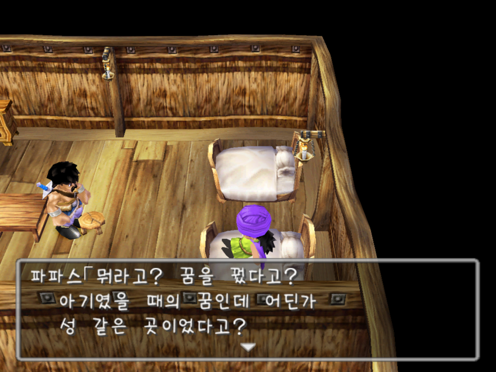

## 👰 드래곤 퀘스트 5 천공의 신부 (Dragon Quest V)

  
  
  
  

### [드래곤 퀘스트 5 한글패치판 롬파일 다운로드](https://link-center.net/538170/XBeZrkOF1oT8)

**드래곤 퀘스트 V 천공의 신부(ドラゴンクエストV 天空の花嫁)**는 1992년 슈퍼 패미컴으로 처음 발매된 시리즈 5편을, 2004년 3월 25일 스퀘어 에닉스가 PS2로 완전히 리메이크한 작품입니다. 마을과 던전이 모두 3D 폴리곤으로 재구성되었고, 음악 역시 **NHK 교향악단**이 연주한 오케스트라 음원으로 교체되는 등 전면적인 스케일업을 거쳤습니다. 발매 이틀 만에 130만 장이 출하될 정도로 당시 일본에서 폭발적인 인기를 끈 작품입니다.

아버지와 아들, 두 세대에 걸쳐 펼쳐지는 대서사와, 시리즈 최초로 도입된 **몬스터 동료 시스템**으로 지금까지도 "드래곤 퀘스트 시리즈 최고의 스토리"로 꼽히는 명작입니다.

---

## 📅 출시 정보

| 항목 | 내용 |
|------|------|
| SFC 원작 발매일 | 1992년 9월 27일 (일본) |
| PS2 리메이크 발매일 | 2004년 3월 25일 (일본) |
| 개발 | 하이브레인 (HeartBeat) |
| 퍼블리셔 | 스퀘어 에닉스 (Square Enix) |
| 시나리오 | 호리이 유지 (堀井雄二) |
| 캐릭터 디자인 | 토리야마 아키라 (鳥山明) |
| 음악 | 스기야마 코이치, NHK 교향악단 연주 |
| 장르 | 턴제 RPG |
| 플랫폼 | PlayStation 2 |

---

## 🗂️ 드래곤 퀘스트 시리즈 흐름

| 작품 | 연도 | 플랫폼 |
|------|------|--------|
| 드래곤 퀘스트 4 | 1990 | FC |
| **드래곤 퀘스트 5 천공의 신부** | **1992 (FC) / 2004 (PS2 리메이크)** | **FC/SFC / PS2** |
| 드래곤 퀘스트 6 몽환의 대지 | 1995 | SFC |
| 드래곤 퀘스트 8 | 2004 | PS2 |

5편은 시리즈 내에서도 유독 "주인공의 일생"을 다루는 독특한 구성으로 꼽히며, PS2 리메이크판은 이후 2008년 NDS로 재이식되기 전까지 가장 완성도 높은 버전으로 평가받았습니다.

---

## 📖 스토리

### 아버지와 함께한 어린 시절

주인공은 전설의 혈통을 지닌 아버지 **판크라스**와 함께 세계를 여행하는 어린 시절을 보냅니다. 아버지와의 모험 속에서 주인공은 세계 각지의 몬스터와 사람들을 만나며 성장해 나갑니다.

### 노예 생활과 성장

여정 중 비극적인 사건으로 아버지를 잃은 주인공은 수년간 노예로 끌려가 혹독한 시간을 보내게 됩니다. 이 기나긴 수난의 시간은 시리즈 내에서도 유독 감정적인 전개로 꼽히며, 주인공이 겪는 세월의 무게를 절실하게 전달합니다.

### 결혼과 가정, 그리고 다음 세대

성인이 된 주인공은 소꿉친구 **비안카**와 왕국의 공주 **플로라** 중 한 명을 아내로 맞이하는 선택을 하게 됩니다. 결혼 이후 자녀를 얻고, 그 자녀와 함께 세계를 위협하는 악의 세력에 맞서는 이야기로 발전하는 구성은 시리즈를 대표하는 서사적 장치로 꼽힙니다.

---

## 🧑‍🤝‍🧑 주요 등장인물

| 캐릭터 | 특징 |
|------|------|
| 주인공 | 전설의 혈통을 지닌 아버지의 아들, 어린 시절부터 성인까지의 일생을 플레이 |
| 판크라스 | 주인공의 아버지, 여정 초반 함께하는 동료 |
| 비안카 | 주인공의 소꿉친구, 결혼 상대 후보 중 한 명 |
| 플로라 | 왕국의 공주, 결혼 상대 후보 중 한 명 |
| 주인공의 자녀 | 성장한 주인공과 아내 사이에서 태어나는 다음 세대 |

---

## ⚙️ 핵심 시스템

### 몬스터 동료 시스템

시리즈 최초로 도입된 **몬스터 동료 시스템**을 통해, 전투 중 조건을 만족한 몬스터를 동료로 영입할 수 있습니다. 슬라임부터 강력한 몬스터까지 다양한 개체를 파티에 합류시켜 독자적인 파티를 구성하는 재미를 제공합니다.

### 결혼 이벤트

비안카와 플로라 중 한 명을 아내로 선택하는 결혼 이벤트는 시리즈 내에서도 가장 유명한 장면 중 하나입니다. 선택에 따라 이후 이야기의 분위기와 일부 대사가 달라집니다.

### PS2판 그래픽·사운드 전면 강화

PS2 리메이크판에서는 마을과 던전이 모두 3D 폴리곤으로 재구성되었고, 몬스터에도 모션이 추가되었습니다. 음악 역시 NHK 교향악단이 연주한 오케스트라 음원으로 교체되어, SFC 원작과는 비교할 수 없는 스케일을 자랑합니다.

---

## 🔄 SFC 원작과 PS2 리메이크 비교

| 항목 | SFC 원작 (1992) | PS2 리메이크 (2004) |
|------|------|------|
| 그래픽 | SFC 사양의 도트 그래픽 | 마을·던전 전면 3D 폴리곤화 |
| 몬스터 | 도트 그래픽 몬스터 | 모션이 추가된 3D 몬스터 |
| 음악 | SFC 음원 | NHK 교향악단 연주 오케스트라 음원 |
| 결혼 상대 | 비안카·플로라 2명 | 비안카·플로라 2명 (동일) |

그래픽과 사운드가 전면적으로 업그레이드되었음에도 원작의 핵심 서사와 시스템은 그대로 유지되어, PS2판은 원작의 감동을 해치지 않으면서도 완전히 새로운 경험을 선사하는 리메이크로 평가받습니다.

---

## 🏆 발매 당시의 반향

PS2판 드래곤 퀘스트 5는 발매 이틀 만에 130만 장이 출하되는 기록을 세우며, 당시 일본 게임 시장에서 가장 큰 화제작 중 하나로 떠올랐습니다. 이러한 인기는 이후 2008년 NDS판으로 재이식되는 데에도 영향을 미쳤으며, 시리즈 중에서도 꾸준히 재조명받는 작품으로 자리매김했습니다.

---

## 💡 공략 팁

### 1. 초반부터 쓸만한 몬스터는 적극 영입

몬스터 동료 시스템은 초반부터 적극 활용할수록 파티 구성의 폭이 넓어집니다. 전투 중 테이밍 기회를 놓치지 말고 다양한 몬스터를 영입해두세요.

### 2. 결혼 상대 선택은 신중하게

비안카와 플로라 중 선택은 이후 이야기 전반에 영향을 미칩니다. 공략 정보를 참고해 자신이 원하는 전개를 미리 파악한 뒤 선택하는 것을 추천합니다.

### 3. 노예 시절 구간은 침착하게 진행

주인공이 겪는 노예 생활 구간은 전개상 답답하게 느껴질 수 있지만, 이후 이야기의 감정적 깊이를 위한 중요한 과정입니다. 서두르지 말고 차근차근 진행하세요.

### 4. 자녀 세대의 능력치도 꼼꼼히 관리

주인공의 자녀가 파티에 합류한 이후에는 그들의 성장도 꾸준히 관리해야 합니다. 후반부 고난이도 전투에 대비해 균형 있게 육성하세요.

---

## 🎨 그래픽·사운드

| 항목 | 평가 |
|------|------|
| 그래픽 | SFC 원작 대비 전면 3D화된 마을과 던전 비주얼 |
| 연출 | 세대를 넘나드는 서사를 살린 섬세한 이벤트 연출 |
| 음악 | NHK 교향악단이 연주한 풍성한 오케스트라 OST |
| 사운드 | 몬스터 동료들의 개성을 살린 효과음 구성 |

---

## 🎯 추천 대상

| 대상 | 이유 |
|------|------|
| 드래곤 퀘스트 시리즈 팬 | 시리즈 최고의 스토리로 꼽히는 명작 |
| 세대를 넘나드는 서사를 좋아하는 사람 | 아버지와 아들, 두 세대에 걸친 대서사 |
| 몬스터 수집·육성을 즐기는 사람 | 시리즈 최초의 몬스터 동료 시스템 |
| 클래식 턴제 RPG를 찾는 사람 | PS2 사양으로 완전히 재탄생한 완성도 |

---

## 📝 총정리

| 항목 | 내용 |
|------|------|
| 개발 | 하이브레인 (HeartBeat) |
| 퍼블리셔 | 스퀘어 에닉스 (Square Enix) |
| 플랫폼 | PlayStation 2 |
| 발매 | 2004년 3월 25일 (일본) |
| 장르 | 턴제 RPG |
| 강점 | 세대를 넘나드는 감동적인 서사, 몬스터 동료 시스템, 오케스트라 OST |
| 약점 | 노예 생활 구간 등 다소 느린 중반 전개 |
| 오버올 | ★★★★★ (시리즈 최고의 스토리로 꼽히는 완성도 높은 리메이크) |

**드래곤 퀘스트 5 천공의 신부**는 아버지와 아들, 두 세대에 걸친 대서사와 시리즈 최초의 몬스터 동료 시스템으로 완성된 작품입니다. PS2 리메이크를 통해 그래픽과 음악까지 전면적으로 업그레이드되며, 발매 이틀 만에 130만 장을 출하한 기록처럼 지금도 시리즈 최고의 명작으로 꼽히는 작품입니다.

---

## 🔗 참고 링크

- [드래곤 퀘스트 5 한글패치판 롬파일 다운로드](https://link-center.net/538170/XBeZrkOF1oT8)
- [Dragon Quest V — Wikipedia](https://en.wikipedia.org/wiki/Dragon_Quest_V)
