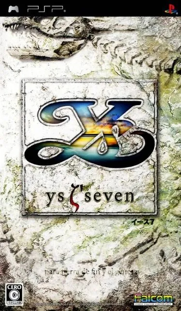
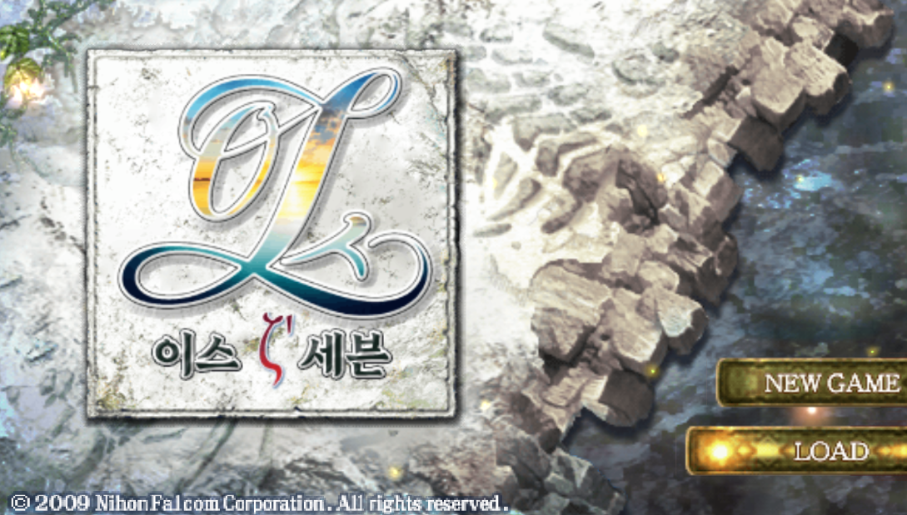
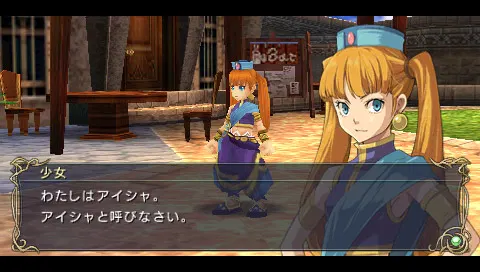
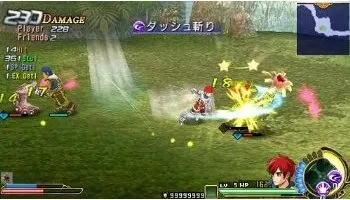

## ⚔️ 이스 7 (イースSEVEN)

  
  
  
  

### [이스 7 한글패치판 롬파일 다운로드](https://link-center.net/538170/jW4EPfx9bllz)

**이스 7(イースSEVEN)**은 2009년 9월 팔콤(Falcom)이 발매한 PSP용 액션 RPG로, 시리즈 역사상 **최초로 완전한 3D 그래픽**과 **파티 전투 시스템**을 도입한 전환점이 된 작품입니다. 그간 단독 모험가로 활약하던 주인공 아돌 크리스틴이 이 작품부터는 여러 동료와 함께 실시간으로 전투 캐릭터를 전환하며 싸우게 되면서, 시리즈의 전투 경험 자체가 크게 달라졌습니다.

전란을 딛고 평화를 되찾아가는 왕국 **알타고**를 무대로 한 이야기와, 캐릭터마다 고유한 **EX 스킬**을 통한 전략적인 전투로 발매 당시 많은 호평을 받은 작품입니다.

---

## 📅 출시 정보

| 항목 | 내용 |
|------|------|
| 발매일 | 2009년 9월 (일본) |
| 개발/퍼블리셔 | 팔콤 (Falcom) |
| 북미 발매 | 2010년 8월 17일 (XSEED Games) |
| 장르 | 액션 RPG |
| 플랫폼 | PlayStation Portable |

---

## 🗂️ 이스 시리즈 흐름

| 작품 | 연도 | 플랫폼 |
|------|------|--------|
| 이스 6: 나피슈텐의 보석 | 2003 | PC |
| 이스 오리진 | 2006 | PC |
| **이스 7** | **2009** | **PSP** |
| 이스 셀세타의 수해 | 2012 | PSV |

7편은 시리즈가 거치형·PC 중심에서 PSP라는 휴대용 플랫폼으로 완전히 자리를 옮기면서, 동시에 전투 시스템 전반을 혁신한 분기점으로 평가받습니다.

---

## 📖 스토리

### 전란 끝에 평화를 되찾은 왕국, 알타고

모험가 **아돌 크리스틴**은 오랜 동료 **도기**와 함께 왕국 **알타고**에 도착합니다. 알타고는 로문 제국과의 길고 처절한 전쟁을 끝내고 새로운 평화를 재건해가는 과정에 있는 나라로, 아돌 일행은 도착하자마자 이 왕국을 둘러싼 심상치 않은 사건에 휘말리게 됩니다.

### 다섯 용의 전설

알타고에는 고대로부터 전해지는 **다섯 용**에 대한 전설이 존재하며, 이 전설은 왕국의 역사와 운명에 깊이 연관되어 있습니다. 아돌 일행은 사건을 파헤치는 과정에서 전설의 진실과, 세계를 위협하는 거대한 위기에 맞닥뜨리게 됩니다.

### 또 하나의 모험, 또 하나의 전설

이스 시리즈 전통대로 아돌은 새로운 땅에서 새로운 동료들과 함께 또 하나의 모험을 완성해 나갑니다. 알타고라는 지명은 고대 도시 카르타고를 변형한 이름으로, 이국적인 분위기의 세계관을 형성하는 요소로 작용합니다.

---

## 🧑‍🤝‍🧑 주요 등장인물

| 캐릭터 | 특징 |
|------|------|
| 아돌 크리스틴 | 붉은 머리의 모험가, 시리즈의 영원한 주인공 |
| 도기 | 아돌의 오랜 동료, 힘을 앞세운 전투 스타일 |
| 알타고의 동료들 | 여정 중 합류하는 다양한 특기를 지닌 파티원들 |
| 로문 제국 | 알타고와 오랜 전쟁을 벌였던 과거의 적대 세력 |

---

## ⚙️ 핵심 시스템

### 시리즈 최초의 파티 전투 시스템

이전까지 아돌이 홀로 싸우던 전투 방식에서 벗어나, 최대 3명의 파티원을 실시간으로 전환하며 싸우는 **파티 전투 시스템**이 처음 도입되었습니다. 캐릭터별 공격 속성(절단·타격·관통)을 활용해 적의 약점을 노리는 전략이 핵심입니다.

### 완전한 3D 그래픽

시리즈 최초로 필드와 캐릭터 모두 완전한 3D로 구현되었습니다. 이전 2D·2.5D 기반 작품들과는 전혀 다른 입체적인 탐험과 전투 경험을 제공합니다.

### 무기 장착형 스킬 시스템

전투 스킬은 장비한 무기에 연동되는 방식으로 습득·사용됩니다. 무기를 교체하면 사용할 수 있는 스킬 구성도 달라져, 상황에 맞는 무기 선택이 전투의 중요한 변수로 작용합니다.

### EX 스킬

각 캐릭터는 고유한 강력한 필살기인 **EX 스킬**을 보유합니다. 게이지를 모아 발동하는 이 스킬은 전투의 흐름을 뒤바꾸는 결정적인 한 수로 활용됩니다.

---

## 🔄 전작들과의 비교

| 항목 | 이스 6/오리진 (2003/2006) | 이스 7 (2009) |
|------|------|------|
| 전투 방식 | 아돌 단독 플레이 | 최대 3인 파티 전환 전투 |
| 그래픽 | 2D/2.5D 기반 | 완전한 3D 구현 |
| 스킬 체계 | 캐릭터 고유 기술 중심 | 무기 장착형 스킬 + EX 스킬 |
| 플랫폼 | PC 중심 | PSP로 플랫폼 전환 |

전투 방식부터 플랫폼까지 거의 모든 면이 달라졌음에도, 속도감 있는 액션성과 아돌이라는 변치 않는 주인공 덕분에 이스 7은 "달라졌지만 여전히 이스답다"는 평가를 받았습니다.

---

## 🌍 시리즈에 남긴 영향

이스 7에서 처음 도입된 파티 전투 시스템과 완전한 3D화는 이후 발매된 이스 셀세타의 수해, 이스 8 등 후속작에도 그대로 계승되어 시리즈의 표준으로 자리 잡았습니다. 단발성 실험이 아니라 시리즈 전체의 방향을 바꾼 전환점이었다는 점에서, 7편의 의미는 더욱 특별합니다.

---

## 💡 공략 팁

### 1. 적의 속성에 맞춰 캐릭터 전환

적마다 절단·타격·관통 중 약한 속성이 다릅니다. 전투 중 수시로 캐릭터를 전환해 약점을 공략하면 전투 시간을 크게 줄일 수 있습니다.

### 2. 무기별 스킬 구성을 미리 파악

무기를 교체하기 전에 어떤 스킬이 연동되는지 확인해두면, 전투 상황에 맞춰 최적의 무기를 빠르게 선택할 수 있습니다.

### 3. EX 게이지는 보스전을 위해 아껴두기

일반 전투에서 EX 스킬을 남발하기보다, 보스전처럼 결정적인 순간을 위해 게이지를 아껴두는 운용이 효율적입니다.

### 4. 파티원 전원을 균형 있게 육성

특정 캐릭터만 집중적으로 사용하기보다, 파티원 전체를 번갈아 기용해 레벨 격차를 줄여두면 후반 고난이도 전투에서 선택의 폭이 넓어집니다.

---

## 🎨 그래픽·사운드

| 항목 | 평가 |
|------|------|
| 그래픽 | 시리즈 최초의 완전한 3D 필드와 캐릭터 비주얼 |
| 연출 | 전란 이후 재건 중인 왕국의 분위기를 살린 이벤트 신 |
| 음악 | 팔콤 특유의 속도감 있는 락 기반 BGM |
| 사운드 | 파티 전투의 타격감을 살리는 속성별 효과음 |

---

## 🎯 추천 대상

| 대상 | 이유 |
|------|------|
| 이스 시리즈 팬 | 시리즈의 전환점이 된 파티 전투 시스템 체험 |
| 속도감 있는 액션 RPG를 좋아하는 사람 | 속성 전환과 EX 스킬의 전략적인 전투 |
| 새로운 세계관을 탐험하고 싶은 사람 | 알타고라는 독창적인 무대와 다섯 용의 전설 |
| PSP 명작 RPG를 찾는 사람 | 발매 당시 높은 평가를 받은 완성도 |

---

## 📝 총정리

| 항목 | 내용 |
|------|------|
| 개발/퍼블리셔 | 팔콤 (Falcom) |
| 플랫폼 | PlayStation Portable |
| 발매 | 2009년 9월 (일본) |
| 장르 | 액션 RPG |
| 강점 | 시리즈 최초의 파티 전투, 완전한 3D화, EX 스킬의 전략성 |
| 약점 | 기존 솔로 플레이 방식에 익숙한 팬에겐 낯선 변화 |
| 오버올 | ★★★★★ (시리즈의 전투 시스템을 재정의한 전환점 작품) |

**이스 7**은 전란을 딛고 재건 중인 왕국 알타고를 무대로, 시리즈 최초의 파티 전투 시스템과 완전한 3D화를 선보인 전환점이 된 작품입니다. 속성을 활용한 전략적인 전투와 EX 스킬의 손맛까지 더해져, 이후 시리즈가 나아갈 방향을 제시한 의미 있는 명작으로 평가받습니다.

---

## 🔗 참고 링크

- [이스 7 한글패치판 롬파일 다운로드](https://link-center.net/538170/jW4EPfx9bllz)
- [Ys SEVEN — Wikipedia](https://en.wikipedia.org/wiki/Ys_SEVEN)
