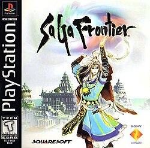
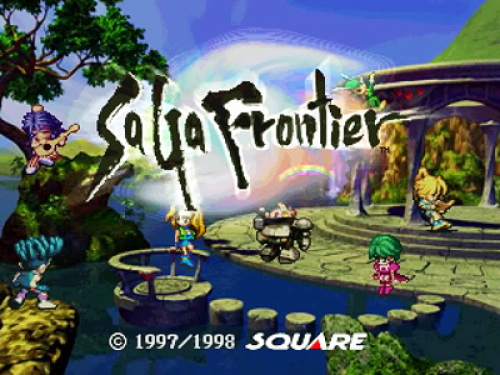
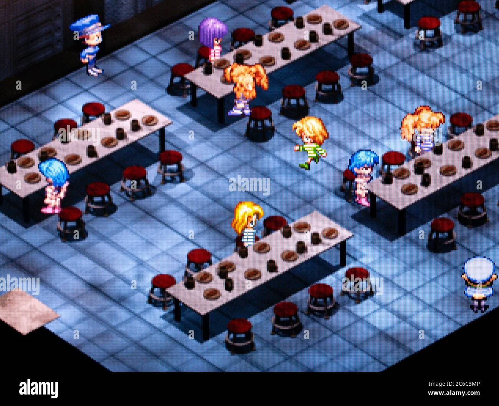

## 🌌 사가 프론티어 (サガ フロンティア)

  
  
  
  

### [사가 프론티어 한글패치판 롬파일 다운로드](https://link-center.net/538170/YIqLqFTum4Zy)

**사가 프론티어(サガ フロンティア)**는 1997년 7월 11일 스퀘어(Square)가 발매한 PS1용 RPG로, 가와즈 아키토시가 디렉터와 프로듀서를 맡은 **사가 시리즈**의 PS1 첫 작품입니다. 개발 초기에는 로맨싱 사가 4라는 제목으로 기획되었으나, 완성 단계에서 독립된 새 타이틀 사가 프론티어로 발매되었습니다.

**일곱 명의 주인공** 중 누구로든 시작할 수 있는 자유로운 구성과, 전통적인 레벨업 대신 전투 중 우연히 기술을 터득하는 독창적인 성장 방식으로 당시 다른 RPG와는 완전히 다른 경험을 제공한 작품입니다.

---

## 📅 출시 정보

| 항목 | 내용 |
|------|------|
| 발매일 | 1997년 7월 11일 (일본) |
| 개발/퍼블리셔 | 스퀘어 (Square) |
| 디렉터/프로듀서 | 가와즈 아키토시 (河津秋敏) |
| 음악 | 이토 켄지 (伊藤賢治) |
| 장르 | 턴제 RPG |
| 플랫폼 | PlayStation |

---

## 🗂️ 사가 시리즈 흐름

| 작품 | 연도 | 플랫폼 |
|------|------|--------|
| 로맨싱 사가 3 | 1995 | SFC |
| **사가 프론티어** | **1997** | **PS1** |
| 사가 프론티어 2 | 1999 | PS1 |
| 언리미티드 사가 | 2002 | PS2 |

사가 프론티어는 SFC 시절 로맨싱 사가 시리즈의 자유도를 계승하면서도, PS1의 성능을 살려 SF적 색채와 여러 행성을 넘나드는 세계관으로 시리즈를 한 단계 확장한 작품입니다.

---

## 📖 스토리

### 일곱 개의 독립된 이야기

이 작품의 가장 큰 특징은 **일곱 명의 주인공** 중 하나를 선택해 각자의 독립된 시나리오를 플레이한다는 점입니다. 용병 **레드**, 변이 능력을 지닌 **아셀루스**, 로봇 **T260G**, 여우를 닮은 생명체 **루마크스 리키** 등 서로 다른 배경과 목적을 가진 주인공들의 이야기가 같은 세계관 안에서 펼쳐집니다.

### 리전이라 불리는 여러 행성

이야기의 무대는 **리전(Region)**이라 불리는 여러 행성으로 이루어진 태양계입니다. 플레이어는 행성 사이를 자유롭게 이동하며 각 주인공의 목적에 맞는 여정을 이어갈 수 있습니다.

### 모든 시나리오를 넘어선 뒤

일곱 명의 주인공 시나리오를 모두 클리어하면 숨겨진 공간이 열리며, 그 안에서 최종 보스와 마주하거나 개발진을 상징하는 존재와 대화할 수 있는 특별한 엔드 콘텐츠가 마련되어 있습니다.

---

## 🧑‍🤝‍🧑 주요 주인공

| 캐릭터 | 특징 |
|------|------|
| 레드 | 가면을 쓴 용병, 복수를 위한 여정을 떠나는 주인공 |
| 아셀루스 | 변이 능력을 지닌 소녀, 자신의 정체성을 둘러싼 이야기 |
| T260G | 자아를 가진 로봇, 자신의 존재 의미를 찾아가는 주인공 |
| 루마크스 리키 | 마지막 남은 종족 루마크스, 동족을 찾는 여정 |
| 블루 / 에밀리아 / 류트 | 각자 다른 목적과 사연을 지닌 나머지 세 주인공 |

---

## ⚙️ 핵심 시스템

### 자유 시나리오 시스템

정해진 선형 진행 없이, 플레이어가 원하는 순서로 이벤트를 찾아다니며 이야기를 진행하는 **자유 시나리오 시스템**을 채택했습니다. 자유도가 매우 높은 만큼, 스스로 목표를 찾아 탐험해야 하는 독특한 플레이 경험을 제공합니다.

### 글리머(Glimmer) 기술 습득

전통적인 경험치·레벨업 방식이 아니라, 전투 중 일정 조건을 만족하면 무작위로 새로운 기술을 **번뜩임(글리머)**처럼 습득하는 방식을 채택했습니다. 같은 행동을 반복한다고 반드시 성장하는 것이 아니라는 점이 시리즈 특유의 개성입니다.

### 종족별 성장 방식의 차이

인간·몬스터·로봇·미스틱 등 캐릭터의 종족에 따라 성장 방식이 크게 다릅니다. 로봇은 부품을 교체해 능력을 바꾸고, 몬스터는 다른 몬스터를 먹어 변이하는 등 각기 다른 육성 전략이 필요합니다.

---

## 🚪 모든 시나리오 너머의 2nd 디비전

일곱 명의 주인공 시나리오를 전부 클리어하면 열리는 숨겨진 공간 **2nd 디비전**은, 단순한 보너스 던전을 넘어 개발진의 메타적인 유머가 담긴 독특한 콘텐츠로 꼽힙니다. 이곳에서는 최종 보스와의 결전뿐 아니라, 개발진을 상징하는 존재와의 대화 이벤트도 마련되어 있어 시리즈 팬들에게 깊은 인상을 남겼습니다.

---

## 🔄 로맨싱 사가 시리즈와의 차이

| 항목 | 로맨싱 사가 3 (SFC, 1995) | 사가 프론티어 (PS1, 1997) |
|------|------|------|
| 세계관 | 중세 판타지 중심 | SF적 색채가 강한 여러 행성 세계 |
| 주인공 수 | 다수의 선택 캐릭터 | 일곱 명의 독립된 시나리오 |
| 그래픽 | SFC 사양 도트 그래픽 | 2D 스프라이트 + 3D 회전 배경 |
| 자유도 | 자유로운 진행 방식 계승 | 자유 시나리오 시스템으로 한층 확장 |

로맨싱 사가 시리즈가 쌓아온 자유도의 전통을 계승하면서도, PS1의 성능과 SF적 설정을 더해 완전히 새로운 색깔을 입힌 것이 사가 프론티어의 핵심적인 성취입니다.

---

## 💡 공략 팁

### 1. 막막하면 먼저 마을을 둘러보기

자유 시나리오 시스템 특성상 다음에 뭘 해야 할지 불명확할 때가 많습니다. 막힌다면 주변 마을의 NPC 대화를 꼼꼼히 확인해 힌트를 얻으세요.

### 2. 글리머를 유도하려면 다양한 행동 시도

특정 기술을 배우고 싶다면 관련된 무기나 행동을 반복적으로 시도해보는 것이 유리합니다. 다양한 전투 상황을 경험할수록 새로운 기술을 익힐 기회가 늘어납니다.

### 3. 종족에 맞는 육성 전략 파악

로봇은 파츠 교체, 몬스터는 포식을 통한 변이 등 종족별 성장 방식이 다릅니다. 파티 구성원의 종족 특성을 미리 이해하고 그에 맞춰 육성하세요.

### 4. 처음에는 짧은 시나리오부터 플레이

주인공별로 시나리오 분량 차이가 큰 편입니다. 시스템에 익숙해지고 싶다면 비교적 짧은 시나리오로 먼저 전체 흐름을 파악하는 것을 추천합니다.

---

## 🎨 그래픽·사운드

| 항목 | 평가 |
|------|------|
| 그래픽 | 2D 스프라이트 캐릭터와 회전하는 3D 배경이 어우러진 독특한 비주얼 |
| 연출 | 주인공마다 다른 색채를 지닌 개성 있는 이벤트 연출 |
| 음악 | 이토 켄지 작곡, 신비로운 분위기의 시리즈 특유 OST |
| 사운드 | 전투 타격감을 살리는 간결한 효과음 구성 |

---

## 🎯 추천 대상

| 대상 | 이유 |
|------|------|
| 사가 시리즈 팬 | PS1 첫 작품이자 시리즈 자유도의 정점 |
| 비선형적인 자유도를 좋아하는 사람 | 자유 시나리오 시스템만의 독창적인 탐험 |
| 독특한 성장 시스템을 즐기는 사람 | 글리머와 종족별 육성 방식의 개성 |
| 여러 번 다시 플레이하고 싶은 사람 | 일곱 명의 주인공마다 다른 이야기 |

---

## 📝 총정리

| 항목 | 내용 |
|------|------|
| 개발/퍼블리셔 | 스퀘어 (Square) |
| 플랫폼 | PlayStation |
| 발매 | 1997년 7월 11일 (일본) |
| 장르 | 턴제 RPG |
| 강점 | 자유 시나리오 시스템, 일곱 명의 독립된 주인공, 독창적인 글리머 성장 |
| 약점 | 불친절한 진행으로 인한 높은 진입 장벽 |
| 오버올 | ★★★★☆ (자유도와 개성으로 승부하는 사가 시리즈의 대표작) |

**사가 프론티어**는 일곱 명의 주인공 중 누구로든 시작할 수 있는 자유로운 구성과, 글리머를 통한 독창적인 성장 방식으로 완성된 작품입니다. 불친절할 정도로 높은 자유도가 오히려 시리즈만의 매력으로 다가오며, 지금까지도 사가 시리즈를 대표하는 개성 있는 명작으로 꼽힙니다.

---

## 🔗 참고 링크

- [사가 프론티어 한글패치판 롬파일 다운로드](https://link-center.net/538170/YIqLqFTum4Zy)
- [SaGa Frontier — Wikipedia](https://en.wikipedia.org/wiki/SaGa_Frontier)
