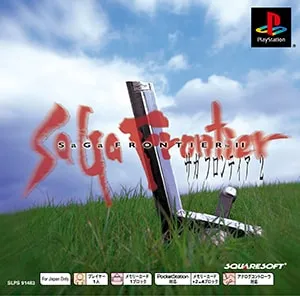
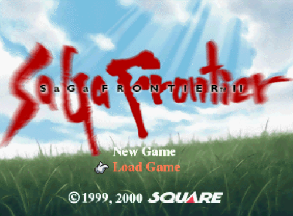
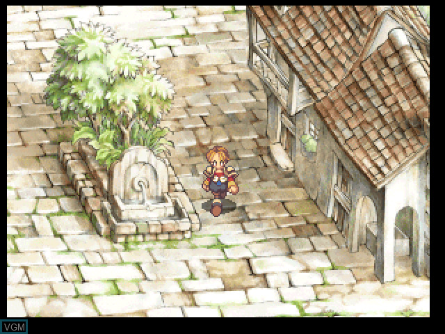
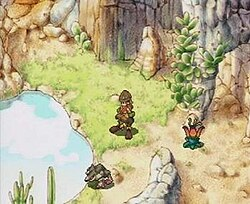

## 🎨 사가 프론티어 2 (サガ フロンティア2)

  
  
  
  

### [사가 프론티어 2 한글패치판 롬파일 다운로드](https://link-hub.net/538170/eOUl8S1QTTsE)

**사가 프론티어 2(サガ フロンティア2)**는 1999년 4월 1일 스퀘어(Square)가 발매한 PS1용 RPG로, 전작의 자유 시나리오 시스템과는 전혀 다른 방식으로 이야기를 풀어낸 속편입니다. 일러스트레이터 **코바야시 토모미**가 그려낸 수채화풍 비주얼이 전작의 SF적 색채와는 완전히 다른 분위기를 만들어내며, 지금도 시리즈 내에서 독보적인 미술적 완성도로 회자되는 작품입니다.

두 가문의 **80여 년에 걸친 역사**를 그려내는 거대한 시간의 흐름과, 역사적 사건을 선택해 진행하는 독창적인 서사 구조로 전작과는 또 다른 매력을 선보입니다.

---

## 📅 출시 정보

| 항목 | 내용 |
|------|------|
| 발매일 | 1999년 4월 1일 (일본) |
| 개발/퍼블리셔 | 스퀘어 (Square) |
| 북미 발매일 | 2000년 1월 31일 |
| 아트 디렉션 | 코바야시 토모미 (小林智美) |
| 장르 | 턴제 RPG |
| 플랫폼 | PlayStation |

---

## 🗂️ 사가 시리즈 흐름

| 작품 | 연도 | 플랫폼 |
|------|------|--------|
| 사가 프론티어 | 1997 | PS1 |
| **사가 프론티어 2** | **1999** | **PS1** |
| 언리미티드 사가 | 2002 | PS2 |
| 로맨싱 사가 민스트럴 송 | 2005 | PS2 |

같은 "프론티어"라는 이름을 달고 있지만, 2편은 전작의 SF적 자유도 대신 역사와 가문의 서사를 중심으로 한 완전히 다른 성격의 작품으로 기획되었습니다.

---

## 📖 스토리

### 추방된 황태자, 구스타브 13세

제국의 황태자 **구스타브 13세**는 궁정의 음모로 인해 왕위를 잃고 추방당하는 운명을 맞습니다. 그는 자신의 왕국을 되찾기 위한 길고 고된 여정에 나서며, 그 과정에서 수많은 동료와 적을 만나게 됩니다.

### 또 다른 시선, 윌 나이츠

또 한 명의 주인공 **윌 나이츠**는 전설의 금속 **감광석**을 둘러싼 모험가 가문의 후예입니다. 구스타브와는 전혀 다른 시대와 배경에서 시작되는 그의 이야기는, 시간이 흐르며 점차 구스타브의 역사와 교차하게 됩니다.

### 80여 년에 걸친 거대한 역사

두 주인공의 이야기는 각자 수십 년에 걸친 시간 속에서 전개되며, 세대를 넘나드는 인물들의 흥망성쇠가 거대한 역사적 서사로 완성됩니다. 전작의 "일곱 개의 독립된 이야기" 구조와는 달리, 2편은 하나의 거대한 역사를 두 시점에서 조명하는 구성을 취합니다.

---

## 🧑‍🤝‍🧑 주요 등장인물

| 캐릭터 | 특징 |
|------|------|
| 구스타브 13세 | 추방당한 제국의 황태자, 왕위 회복을 꿈꾸는 주인공 |
| 윌 나이츠 | 감광석을 둘러싼 모험가 가문의 후예 |
| 역대 가문의 후손들 | 수십 년에 걸쳐 등장하는 두 가문의 다음 세대 인물들 |
| 제국과 모험가 길드 | 거대한 역사적 사건의 배경이 되는 두 세력 |

---

## ⚙️ 핵심 시스템

### 히스토리 초이스 시스템

연표 형태로 제시되는 여러 역사적 사건 중 원하는 것을 선택해 진행하는 **히스토리 초이스 시스템**을 채택했습니다. 전작의 완전한 자유 탐험 방식보다 한층 구조화된 서사 진행 방식입니다.

### 세대를 넘나드는 캐릭터 교체

이야기가 수십 년에 걸쳐 전개되는 만큼, 시간이 흐르면 기존 캐릭터가 세상을 떠나고 다음 세대 인물이 이야기를 이어가는 구조가 존재합니다. 가문의 흥망성쇠를 체감하게 하는 독특한 장치입니다.

### 전작을 계승한 전투 시스템

기본적인 턴제 전투와 LP(생명력) 시스템은 전작의 틀을 이어받았습니다. 다만 전작의 글리머 방식 대신, 특정 사건(에피소드)을 경험하며 기술을 습득하는 방식으로 조정되었습니다.

### 수채화풍 비주얼

코바야시 토모미가 그려낸 수채화 느낌의 일러스트와 색채가 게임 전반의 비주얼에 깊이 반영되어, 전작의 SF적 색채와는 전혀 다른 서정적인 분위기를 완성했습니다.

---

## 🔄 전작(사가 프론티어)과의 비교

| 항목 | 사가 프론티어 (1997) | 사가 프론티어 2 (1999) |
|------|------|------|
| 서사 구조 | 일곱 명의 독립된 자유 시나리오 | 두 가문의 교차하는 역사 서사 |
| 진행 방식 | 완전 자유 탐험 | 히스토리 초이스 시스템 |
| 성장 방식 | 글리머(무작위 기술 습득) | 사건 경험을 통한 기술 습득 |
| 비주얼 | SF적 색채의 캐릭터 디자인 | 수채화풍의 서정적인 비주얼 |

같은 "프론티어"라는 이름 아래 있지만, 2편은 전작의 자유분방함 대신 치밀하게 설계된 역사극으로 방향을 전환했습니다. 이 과감한 변화는 발매 당시에도 화제가 되었으며, 지금까지도 시리즈 내에서 가장 독자적인 작품으로 평가받는 이유입니다.

---

## 🖌️ 수채화가 만들어낸 분위기

코바야시 토모미의 수채화풍 아트는 단순한 그래픽 스타일을 넘어, 게임 전체에 흐르는 시간의 무게와 쓸쓸함을 시각적으로 전달하는 핵심 장치로 작용합니다. 세대가 바뀌고 인물들이 늙어가는 이야기의 정서와, 번쩍이는 원색 대신 차분한 색감을 택한 비주얼이 절묘하게 어우러지며 발매 당시부터 높은 평가를 받았습니다.

---

## 💡 공략 팁

### 1. 역사적 사건 순서를 전략적으로 선택

히스토리 초이스 시스템에서 선택하는 사건 순서에 따라 캐릭터의 성장과 이후 전개가 달라질 수 있습니다. 공략 정보를 참고해 효율적인 순서를 고려해보세요.

### 2. 세대교체에 대비한 육성

주요 캐릭터가 세상을 떠나는 전개가 존재하므로, 다음 세대 캐릭터도 미리 육성해두면 이야기 전환에 당황하지 않을 수 있습니다.

### 3. 전투에서 다양한 기술 경험 시도

전작처럼 반복되는 전투 패턴보다 다양한 상황을 경험하는 것이 새로운 기술 습득에 유리합니다. 매 전투마다 다른 전략을 시도해보세요.

### 4. 두 주인공의 이야기를 번갈아 진행

구스타브와 윌의 이야기는 결국 교차하는 구조이므로, 한쪽에만 치중하지 말고 번갈아 진행하며 전체 서사를 이해하는 것을 추천합니다.

---

## 🎨 그래픽·사운드

| 항목 | 평가 |
|------|------|
| 그래픽 | 코바야시 토모미의 수채화풍 일러스트가 반영된 독보적인 비주얼 |
| 연출 | 세대를 넘나드는 역사적 서사를 살린 차분한 이벤트 연출 |
| 음악 | 서정적이고 웅장한 분위기를 강조한 OST |
| 사운드 | 전투와 역사적 사건 장면을 살리는 효과음 구성 |

---

## 🎯 추천 대상

| 대상 | 이유 |
|------|------|
| 사가 시리즈 팬 | 전작과는 또 다른 색깔을 보여준 독자적인 속편 |
| 거대한 역사 서사를 좋아하는 사람 | 80여 년에 걸친 두 가문의 흥망성쇠 |
| 미술적으로 완성도 높은 작품을 찾는 사람 | 수채화풍 비주얼이 주는 독보적인 분위기 |
| 전작의 자유도가 부담스러웠던 사람 | 한층 구조화된 히스토리 초이스 시스템 |

---

## 📝 총정리

| 항목 | 내용 |
|------|------|
| 개발/퍼블리셔 | 스퀘어 (Square) |
| 플랫폼 | PlayStation |
| 발매 | 1999년 4월 1일 (일본) |
| 장르 | 턴제 RPG |
| 강점 | 수채화풍 비주얼, 거대한 역사적 서사, 독창적인 히스토리 초이스 시스템 |
| 약점 | 세대교체로 인한 애착 캐릭터와의 이른 작별 |
| 오버올 | ★★★★★ (사가 시리즈 내에서도 독보적인 미술적 완성도를 지닌 명작) |

**사가 프론티어 2**는 구스타브 13세와 윌 나이츠, 두 가문의 80여 년에 걸친 역사를 수채화풍 비주얼로 그려낸 작품입니다. 전작과는 전혀 다른 구조화된 서사 방식을 택했음에도, 시리즈 특유의 깊이와 개성을 잃지 않아 지금까지도 독보적인 명작으로 꼽힙니다.

---

## 🔗 참고 링크

- [사가 프론티어 2 한글패치판 롬파일 다운로드](https://link-hub.net/538170/eOUl8S1QTTsE)
- [SaGa Frontier 2 — Wikipedia](https://en.wikipedia.org/wiki/SaGa_Frontier_2)
