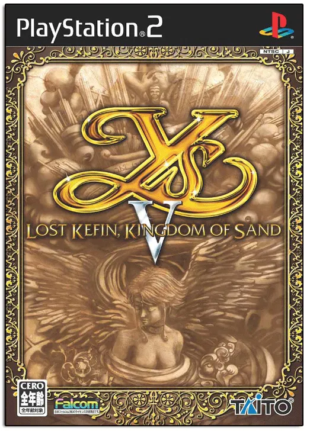
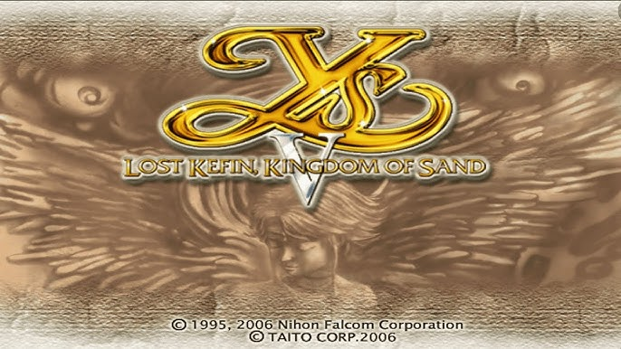
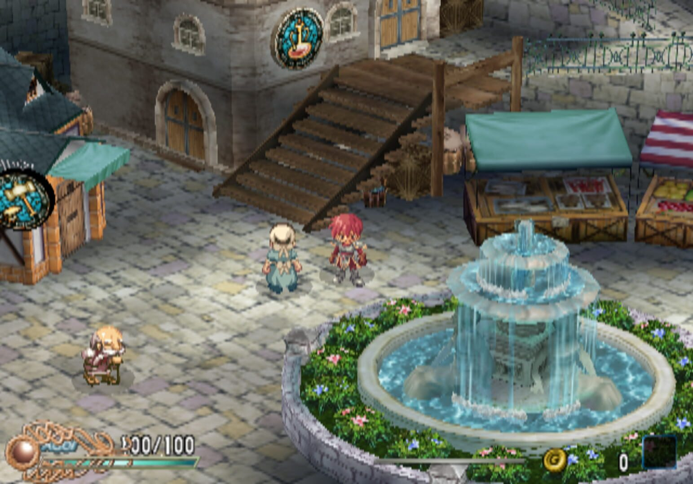
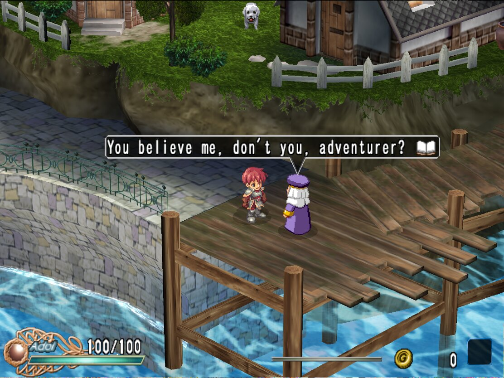

## 🏜️ 이스 5 잃어버린 모래의 도시 케핀 (イースV)

  
  
  
  

### [이스 5 한글패치판 롬파일 다운로드](https://link-center.net/538170/Gdl8Rq9Z4EcY)

**이스 V(イースV)**는 1995년 12월 니혼팔콤(Falcom)이 슈퍼 패미컴으로 처음 발매한 액션 RPG로, 2006년 3월 30일 **타이토(Taito)**가 PS2로 새롭게 이식했습니다. PS2판은 원작의 탑뷰 시점을 **쿼터뷰(사선 후방 시점)**로 전면 재구성했으며, 전투에도 점프 공격·회피·방패 방어 같은 신규 액션이 추가되어 원작과는 또 다른 플레이 감각을 선사합니다.

사막 한가운데 묻힌 고대 도시 **케핀**과 그 비밀을 둘러싼 이야기는, 시리즈 특유의 모험과 신비로운 분위기를 그대로 간직하고 있습니다.

---

## 📅 출시 정보

| 항목 | 내용 |
|------|------|
| SFC 원작 발매일 | 1995년 12월 29일 (일본) |
| PS2판 발매일 | 2006년 3월 30일 (일본) |
| 원작 | 니혼팔콤 (Falcom) |
| PS2판 퍼블리셔 | 타이토 (Taito) |
| 패미통 평가 | 40점 만점에 28점 |
| 장르 | 액션 RPG |
| 플랫폼 | PlayStation 2 |

---

## 🗂️ 이스 시리즈 흐름

| 작품 | 연도 | 플랫폼 |
|------|------|--------|
| 이스 4 | 1993 | PCE/SFC |
| **이스 5 잃어버린 모래의 도시 케핀** | **1995 (SFC) / 2006 (PS2 이식)** | **SFC / PS2** |
| 이스 6 나피슈텐의 보석 | 2003 | PC |
| 이스 7 | 2009 | PSP |

5편은 시리즈 중에서도 상대적으로 덜 알려진 작품으로 꼽히지만, PS2판 이식을 통해 한층 다듬어진 모습으로 새로운 세대의 유저들에게 소개된 작품입니다.

---

## 📖 스토리

### 사막의 땅, 산드리아

모험가 **아돌 크리스틴**은 새로운 대륙 **아프로카**의 사막 도시 **산드리아**에 도착합니다. 황량한 사막 한가운데 자리한 이 도시는 고대부터 전해지는 신비로운 전설을 품고 있으며, 아돌은 그 비밀을 파헤치는 여정에 나서게 됩니다.

### 잃어버린 도시, 케핀의 전설

산드리아 지하에는 오래전 모래 속에 묻혀 사라진 고대 도시 **케핀**의 전설이 전해지고 있습니다. 아돌은 이 전설을 좇으며 사막의 비밀과 세계를 위협하는 거대한 위기에 다가가게 됩니다.

### PS2판에서 재구성된 전개

PS2판에서는 원작 SFC판에 있던 포레스타 동굴 관련 사건이 사라지고, 그 내용이 새로운 네이다 동굴 에피소드로 옮겨지는 등 일부 전개가 재구성되었습니다. 전체적인 줄거리의 큰 틀은 유지하면서도, 세부 구성에 변화를 준 점이 특징입니다.

---

## 🧑‍🤝‍🧑 주요 등장인물

| 캐릭터 | 특징 |
|------|------|
| 아돌 크리스틴 | 붉은 머리의 모험가, 시리즈의 영원한 주인공 |
| 산드리아의 주민들 | 사막 도시를 지키며 살아가는 다양한 인물들 |
| 케핀의 수호자 | 고대 도시에 얽힌 신비로운 존재 |

---

## ⚙️ 핵심 시스템

### 쿼터뷰로 재구성된 시점

원작 SFC판의 정면 탑뷰 시점을, PS2판에서는 사선 후방에서 바라보는 **쿼터뷰**로 전면 재구성했습니다. 입체감 있는 필드 탐험이 가능해지며 전체적인 플레이 느낌이 크게 달라졌습니다.

### 점프와 회피, 방패 방어 추가

전투 중 점프를 이용한 공격과 회피, 방패를 활용한 방어 등 신규 액션이 추가되었습니다. 원작보다 한층 역동적인 전투 운용이 가능해진 것이 특징입니다.

### 연금술 기반 마법 시스템

원작부터 이어진 **연금술**을 활용한 마법 체계가 존재하며, 일반 경험치와 마법 경험치가 분리되어 성장하는 구조를 가지고 있습니다. 전투와 마법 숙련을 동시에 관리해야 하는 점이 독특합니다.

---

## 🔄 SFC 원작과 PS2판 비교

| 항목 | SFC 원작 (1995) | PS2판 (2006) |
|------|------|------|
| 시점 | 정면 탑뷰 | 사선 후방 쿼터뷰 |
| 전투 액션 | 기본 공격 중심 | 점프 공격·회피·방패 방어 추가 |
| 지형 | 평면적인 맵 구성 | 높낮이가 반영된 입체적 맵 |
| 일부 전개 | 포레스타 동굴 에피소드 수록 | 네이다 동굴로 에피소드 재구성 |

단순한 그래픽 업스케일을 넘어 시점과 전투 방식까지 손을 댄 점에서, PS2판은 원작을 아는 유저에게도 새로운 느낌을 주는 재해석에 가까운 이식작으로 평가할 수 있습니다.

---

## 🕰️ 시리즈 내에서 다소 저평가된 이유

이스 5는 전작 4편의 평가에 비해 시리즈 내에서 유독 조용히 지나간 작품으로 꼽힙니다. 패미통 평가도 28점에 머물렀을 만큼 발매 당시 반응이 뜨겁지 않았는데, 이는 시스템 변화가 실제 플레이에 크게 체감되지 않았다는 평가와도 맞물려 있습니다. 그럼에도 사막을 배경으로 한 독특한 분위기와 케핀의 전설은 지금도 재조명할 가치가 있는 매력으로 꼽힙니다.

---

## 💡 공략 팁

### 1. 쿼터뷰 시점에 맞춰 거리감 재조정

원작과 시점이 달라진 만큼, 초반에는 공격과 회피 타이밍의 거리감을 새롭게 익히는 데 시간을 투자하세요.

### 2. 방패 방어를 적극 활용

신규 추가된 방패 방어는 위험한 공격을 무효화하는 데 유용합니다. 무작정 회피하기보다 상황에 맞게 방어를 섞어 쓰는 운용이 효율적입니다.

### 3. 마법 경험치도 꾸준히 관리

일반 경험치만 신경 쓰다 보면 마법 성장이 뒤처지기 쉽습니다. 연금술 마법도 꾸준히 사용해 균형 있게 성장시키세요.

### 4. 점프 공격으로 지형 활용

지형의 높낮이가 반영된 맵이 많으므로, 점프 공격을 활용해 유리한 위치에서 적을 공격하는 전략도 고려해보세요.

---

## 🎨 그래픽·사운드

| 항목 | 평가 |
|------|------|
| 그래픽 | SFC 원작을 PS2 사양으로 재구성한 쿼터뷰 비주얼 |
| 연출 | 사막 도시 산드리아의 황량하면서도 신비로운 분위기 |
| 음악 | 팔콤 특유의 속도감 있는 테마곡 계승 |
| 사운드 | 점프·방어 등 신규 액션에 맞춰 조정된 효과음 |

---

## 🎯 추천 대상

| 대상 | 이유 |
|------|------|
| 이스 시리즈 팬 | 상대적으로 덜 알려진 5편을 새롭게 체험 |
| 사막 배경의 모험을 좋아하는 사람 | 산드리아와 케핀의 신비로운 세계관 |
| 액션성이 강화된 리메이크를 원하는 사람 | 점프·회피·방패 방어가 더해진 전투 |
| PS2 명작 액션 RPG를 찾는 사람 | 쿼터뷰로 새롭게 재구성된 플레이 경험 |

---

## 📝 총정리

| 항목 | 내용 |
|------|------|
| 원작 | 니혼팔콤 (Falcom) |
| PS2판 퍼블리셔 | 타이토 (Taito) |
| 플랫폼 | PlayStation 2 |
| 발매 | 2006년 3월 30일 (일본) |
| 장르 | 액션 RPG |
| 강점 | 쿼터뷰로 재구성된 시점, 점프·방어 등 강화된 전투 액션 |
| 약점 | 시리즈 내에서 상대적으로 낮은 인지도와 평가 |
| 오버올 | ★★★★☆ (상대적으로 덜 알려졌지만 재발견할 가치가 있는 이식작) |

**이스 5 잃어버린 모래의 도시 케핀**은 사막 도시 산드리아를 무대로 한 아돌의 모험을, 쿼터뷰 시점과 강화된 전투 액션으로 새롭게 재구성한 PS2판 이식작입니다. 시리즈 내에서 상대적으로 조명받지 못했던 작품이지만, 이 기회에 재발견해볼 가치가 있는 작품입니다.

---

## 🔗 참고 링크

- [이스 5 한글패치판 롬파일 다운로드](https://link-center.net/538170/Gdl8Rq9Z4EcY)
- [Ys V — Wikipedia](https://en.wikipedia.org/wiki/Ys_V)
